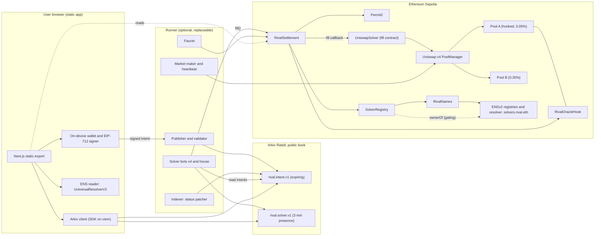
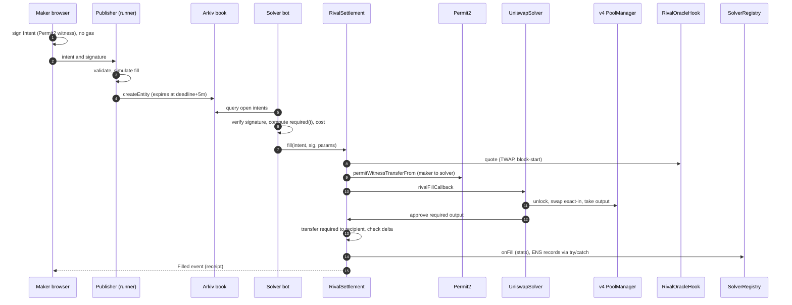
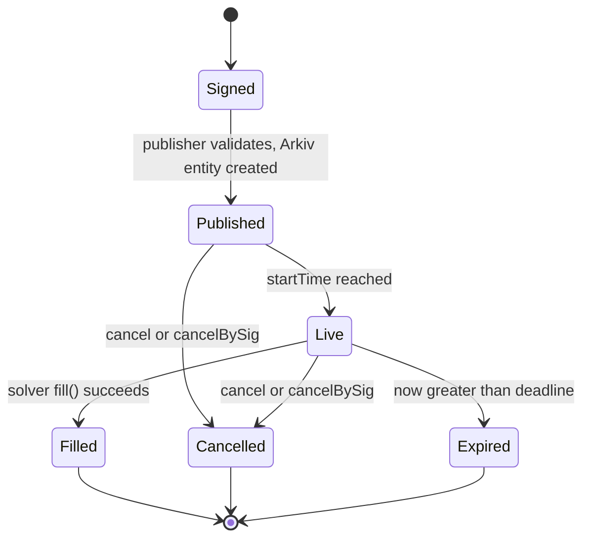
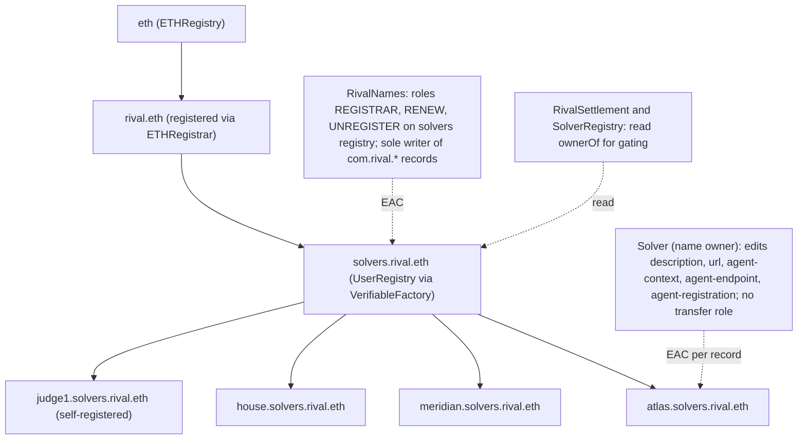
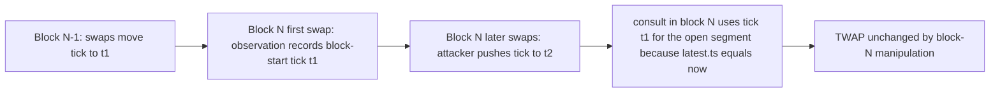

# Rival — Product Requirements Document (v3)

> **Every swap is an auction. Anyone can bid. Everything is verifiable.**
> Rival is an open execution market on Uniswap v4: you sign one gas-free *intent* ("sell 1 ETH, at least this much USDC"), competing **solvers** fight to fill it in public, a **v4 oracle hook** pegs the price to an on-chain TWAP and measures the result, **ENS** gives every solver a verifiable identity and tamper-proof track record, and **Arkiv** is the public order book nobody owns.

| Field | Value |
| --- | --- |
| Event | ETHGlobal Mumbai — submission deadline **Sat 7 Nov 2026, 09:00 IST** |
| Document status | v3, implementation-ready for **autonomous coding agents**. Supersedes archived directions in `archive/` (Plainsight, Bhishi). |
| Authored | Fri 6 Nov 2026, ~01:00 IST. Build clock **H0 = Fri 6 Nov 02:00 IST**; deadline = **H+31 h**. |
| Owner | Solo founder (product + integration owner); primary implementers are intelligent coding agents |
| Networks | Ethereum **Sepolia** (Uniswap v4, Permit2, ENSv2, our contracts); Arkiv **Rabdi** testnet (public order book). Testnet only; unaudited prototype. |
| License | MIT (our code). Third-party licenses declared (§6.7): note `v4-core` is BUSL-1.1 |

**Reading convention.** **[Confirmed]** = verified against a primary source or live probe on 5–6 Nov 2026 (Appendix A). **[Assumption → S#]** = unverified, gated by a numbered spike (Appendix B) with a go/no-go threshold and a pre-written fallback. No prize is guaranteed.

---

## 1. Executive Product Definition

### 1.1 Identity

| | |
| --- | --- |
| **Product name** | **Rival** |
| **One-line description** | An open, verifiable solver market for swaps: sign one gas-free intent, watch solvers compete on-chain to fill it, and see the exact price improvement they delivered. |
| **Primary user** | A **trader or treasury operator** (including AI trading agents) who swaps meaningful size and wants best execution *they can verify*, without gas, without leaking intent to a single venue, and without trusting a gatekeeper. |
| **Secondary user** | A **solver operator** (market maker / searcher / agent builder) who wants an open market with a portable on-chain identity and reputation instead of a permissioned allowlist. |
| **Core USP (exactly one)** | **Open, verifiable best execution.** Intent discovery is a public book, solver identity and performance are on-chain names, and every fill carries an on-chain receipt that compares what you got with a manipulation-resistant fair price. |

### 1.2 Problem statement

Swapping through a pool is a single quote from a single venue: the trader cannot tell whether a better price existed, and size gets picked apart by slippage and MEV. **Intent-based trading** (the trader signs *what* they want; competing solvers decide *how*) is the accepted fix, and UniswapX is the leading deployment. But today's solver markets share three structural gaps, which are documented in Uniswap's own developer docs:

1. **Gatekept discovery.** UniswapX orders are discovered through Uniswap's hosted *orders API* (fillers poll an endpoint). The "book" is a service, not a public commons.
2. **Gatekept identity.** On Ethereum the RFQ *quoter* role is "permissioned, vetted by Uniswap Labs"; solver track records are not a public, queryable, on-chain fact.
3. **Opaque outcomes and absolute-price orders.** The trader sees a filled amount; there is no on-chain receipt that says "you beat fair value by X bps", and orders are priced in absolute amounts, which go stale during the slow, large trades that most need protection (treasuries, DAOs, agents).

> *All three statements are sourced in Appendix A (A-2); agents must not strengthen them beyond the cited text.*

### 1.3 "Why can't a chat model or a normal app do this?" (the design test)

| Alternative | What it can do | What it cannot do (and Rival does) |
| --- | --- | --- |
| **A chat model / AI assistant** | Explain trades, suggest slippage settings, even write the intent | Custody nothing, **enforce a price floor at settlement**, atomically swap assets between strangers, or produce a receipt a third party can verify on-chain |
| **A DEX aggregator UI** | Show the best *quote* | Guarantee the *outcome* (the quote is not a commitment) or let anyone prove it afterwards |
| **UniswapX** | Intent execution with Dutch auctions and permissionless fillers | Public (non-API) order discovery, public solver identity/track record, oracle-pegged pricing, on-chain improvement receipts — Rival is an **open reference design** using the same primitives (Permit2 witness transfer, fill callback), not a replacement claim |
| **A normal web app + database order book** | Everything, *if you trust the operator* | The operator becomes the new gatekeeper: it can reorder, hide, or front-run intents and rewrite solver history |

Judge-ready one-sentence answer: *"A chat model can describe a good trade; only a settlement contract can guarantee the price, only an on-chain name can make a solver's record unforgeable, and only a public book keeps the market open."*

### 1.4 Why this should exist, and why now

- **Intent trading is mainstream but its commons are not.** The market structure (reactors, fillers, quoters) exists; the *open* layers — discovery, identity, receipts — can now be built from public primitives: Arkiv (wallet-owned, expiring, queryable data), ENSv2 (expiring/role-scoped names with per-record permissions), and Uniswap v4 hooks (on-chain oracle and accounting at the pool).
- **Agents are about to be the main traders.** Agents need a venue where constraints are enforceable (hard minimum out), identity is machine-verifiable (ENSIP-25/26 agent records), and discovery is a public API surface.
- **The tooling matured this week.** Uniswap ships v4, Permit2 and production hook libraries; ENSv2 is deployed on Sepolia; Arkiv offers SQL-like public data with expiry — all verified live (Appendix A).

### 1.5 What makes it different

1. **Oracle-pegged intents.** Prices are defined relative to a **block-start TWAP** maintained by a v4 hook, so a slow auction never goes stale ("TWAP + 20 bps decaying to TWAP − 30 bps over 90 s"), with an **absolute hard floor** that is always enforced.
2. **Public book on Arkiv.** Intents and solver presence are expiring, wallet-attributed entities any solver or UI can query with SQL-like filters — no hosted endpoint required.
3. **ENS-native solver identity.** `atlas.solvers.rival.eth` is a non-transferable, expiring-by-inactivity ENSv2 name; performance records (`com.rival.*`) can only be written by the settlement protocol; intents can restrict fills to *listed* or *named* solvers, enforced on-chain by ENS ownership reads.
4. **On-chain receipts.** Every fill emits the exact improvement versus a manipulation-resistant fair price.
5. **Anyone can compete.** A solver template and CLI let a judge run a competing solver in minutes.

**What Rival is not:** a lending/yield product, a bridge, a launchpad, an aggregator of other DEXes, a token, or a claim to replace UniswapX. No mainnet, no real funds, no protocol fee.

---

## 2. Strategic Rationale

### 2.1 Selected sponsor tracks (exactly three partners)

Submission mode: **Finalist and Partner Prizes** (solo finalist payout is 250 USDC; zero extra build).

| # | Partner pick | Track | Cash on offer (card) | Qualification gist | Role in Rival |
| --- | --- | --- | --- | --- | --- |
| 1 | **Uniswap Foundation** | **Build with Uniswap** (from-scratch) | **$10,000** — $4,000 / $3,000 / $2,000 / $1,000 | Public repo, open source; **`FEEDBACK.md`** and a **completed submission of the Uniswap Developer Feedback Form** including the FEEDBACK.md link; README must point to relevant contracts and lines. "New v4 hooks, extensions…, tooling for the broader ecosystem" explicitly in scope | New **v4 oracle hook**, **Permit2 witness** intents, **PoolManager flash-accounting** reference solver, Quoter/StateView reads |
| 2 | **ENS** | **Best Use of ENSv2** | **$7,000** — $3,000 / $2,000 / $1,000 / $1,000 | ENSv2 on mainnet **or Sepolia**; features **central, not cosmetic**; **functional demo, no hard-coded values**; live demo link; open source. Bonus: **agents as namespaces** | Solver identity names, EAC per-record permissions, inactivity expiry, on-chain ownership gating, ENSIP-25/26 agent records |
| 3 | **Arkiv** | **Build on Arkiv (from scratch)** | **$4,000** — $3,000 / $1,000 (+ optional **Swarm bonus $500**, P2) | Writes to Rabdi with `@arkiv-network/sdk`; a user-visible feature **reads** it; `/arkiv/*.md` files; OSS; AI statement. **Not counted:** SDK never used to read, or Arkiv used only as a log | The **public intent book** and **solver presence**: solvers *must read Arkiv to discover work* |

- **Ceiling vs. realistic range (judgment, not data).** Ceiling from first places: $4,000 + $3,000 + $3,000 = **$10,000** (+ $500 Swarm). A realistic planning range is **$0 – $6,000**; competitor counts and judge calibration are unknown. Non-cash perks are valued at zero.
- **Why exactly these three:** each owns a distinct *layer* of the same system — **execution** (Uniswap), **identity & authorization** (ENS), **public data plane** (Arkiv). Remove any one and the product visibly breaks (§6.6).

### 2.2 Exact eligibility requirements (from `prizes.txt` / `research.md`)

**ETHGlobal (all tracks).** Project-specific code begins after kickoff; libraries disclosed. Commit history required (≥ 40 meaningful commits across ≥ 8 PR branches). AI use disclosed (`AI_USAGE.md`, `/specs`, `/prompts` in repo); founder contributions documented (an entirely-AI submission risks ineligibility). ≤ 3 partner picks (this plan uses all three). Optional video 2–4 min, ≥ 720p, no sped-up footage, no TTS voice-over, ≤ 4 bullet slides, ≤ 20 s backstory. Organizer pages conflict on whether partner judging needs **booth presence** → be at the Uniswap, ENS and Arkiv booths Saturday morning.

**Uniswap — Build with Uniswap ($10,000).** Quote: *"Build on or integrate any part of the Uniswap stack, including the Uniswap API, the Uniswap AMM (v2, v3, or v4), CCA, or any other Uniswap protocol. This also includes new v4 hooks, extensions or improvements to official Uniswap repositories, and tooling or solutions built for the broader ecosystem."* Qualification: *"A public GitHub repository with open-source code, a FEEDBACK.md file, and a completed submission to the Uniswap Developer Feedback Form (https://developers.uniswap.org/hackathon-feedback) that includes the link to your FEEDBACK.md file. Submissions without it will be reviewed and audited before winners are finalized. Make sure your README clearly points to the relevant contracts and lines of code so we can verify your integration."* → `FEEDBACK.md` is honest, specific, written continuously; the README has a **line-level integration map** (§12.2); the form is submitted before the deadline.

**ENS — Best Use of ENSv2 ($7,000).** Quote: *"Project must be built on ENSv2 on Ethereum mainnet or Sepolia. ENSv2 features should be central to the product, not a cosmetic add-on. Your demo must be functional and not just include hard-coded values. Upon submission, your project showcase must have a link to a live demo and the code needs to be open source…"*. Feature menu on the card: hierarchical registries; own subname registry; **Enhanced Access Control** ("letting an account edit only certain text records"); Permissioned Resolver; expiring/revocable/non-transferable subnames; *"Bonus points if you bring AI agents into the mix… agents as namespaces, each with their own identity and permissions."*

**Arkiv — Build on Arkiv (from scratch) ($4,000).** Quote: *"Your app writes to Arkiv's current testnet … with @arkiv-network/sdk or the JSON-RPC API, and at least one feature users see reads its data from Arkiv."* README: wallet addresses that wrote entities + **one query we can run**. Files: `/arkiv/schema.md`, `/arkiv/friction.md`, and one per criterion — `/arkiv/reach.md`, `/arkiv/why-arkiv.md`, `/arkiv/how-you-use-arkiv.md` (25 % each). *"Not counted: the SDK installed but never used to read, or Arkiv used only as a log that nothing reads."* One Arkiv track prize per team; Arkiv = one partner pick.

### 2.3 Why the product fits each sponsor's stated objective

- **Uniswap.** The card invites hooks, infrastructure and tooling for the broader ecosystem. Rival adds (i) a **new, tested v4 oracle hook** with same-block manipulation resistance, (ii) an **intent settlement layer** built on Permit2 `permitWitnessTransferFrom` (the same pattern UniswapX documents: validate → resolve → pull via Permit2 with the order as witness → call fill callback → verify outputs), (iii) a reference **fill contract that sources liquidity from the v4 PoolManager** via flash accounting, and (iv) tooling (solver SDK/template, intent book, receipts).
- **ENS.** Names are the identity, permission and reputation substrate of the solver market: `register`/`renew`/`unregister` with expiry, roles at registration (`ROLE_CAN_TRANSFER_ADMIN` withheld → non-transferable), per-record permissions so *only the protocol writes performance*, `ownerOf` (returns zero when expired) as the **on-chain gate**, and ENSIP-25/26 agent records so each solver is a verifiable *agent as a namespace*.
- **Arkiv.** "Agents: ephemeral coordination state: tasks, bids and claims that agents share, query and let expire" is a listed direction. Intents are tasks; solver presence is an ephemeral claim; both expire on their own; **solvers read the book to do their job**, so Arkiv is the primary data path, not a log.

### 2.4 Decisive trade-offs behind the selection

- **Chose a problem where the guarantee is the product.** The value is an enforceable floor and a verifiable receipt — not text, not a UI.
- **Positioned against UniswapX honestly.** We cite UniswapX as the reference pattern and claim only the specific, sourced gaps (open discovery, open identity, pegged pricing, receipts). Judges from Uniswap know UniswapX; overclaiming would cost credibility.
- **Chose Sepolia + our own pair of test tokens and pools** (official v4 PoolManager, our hook). UniswapX is **not deployed on Sepolia** [Confirmed A-2], so Rival ships its own minimal settlement; nothing depends on mainnet liquidity we cannot control.
- **Kept the economic mechanism boring and auditable:** linear decay, one fill per intent, exact-in, no protocol fee, no custody (funds move atomically inside one transaction).
- **No fourth sponsor.** Anything else would be decorative.

### 2.5 Historical winners and competitive lessons (from `research.md`)

| Observation | Lesson applied |
| --- | --- |
| Uniswap winners: OniBlock (v4 hook + offchain model attestation, hook "never reverts"), Bailiff (hook liquidation), VexiHakari (Aqua options + **v4 TWAP quote guard**), Kura, Reckn; Lisbon API prize (KOLlateral, Sentinel, Peregrine…) | Judges reward **hooks with a concrete safety property** and TWAP/oracle guards; **our hook "never reverts" in `beforeSwap`** and ships a manipulation-resistance proof; plus real ecosystem tooling |
| CCA integrations not among winners; production hooks now come from Uniswap Labs themselves (StablePair, VolatilePair: block price caching, mid-block fees) | Don't re-invent a fee/anti-sandwich hook; build a **different primitive** (oracle + settlement) and cite the Labs hooks as adjacent |
| ENS winners: Relay (delegated API access via ENS identities), Radius (subnames as credentials), ENS Subname Manager (roles per resource, revoke on-chain, non-crypto-native flow) | Credential-style subnames are a proven shape; ours adds **behavioral lifecycle** (inactivity expiry) and **protocol-only performance records** + on-chain gating. Relay's own write-up (no ENS contracts) shows judges scrutinize cosmetic ENS → we call real ENSv2 contracts from our contracts |
| Sponsors verify via repo/artifacts (Uniswap audits README pointers; Arkiv requires runnable queries) | Line-level README map; runnable queries; `FEEDBACK.md`; rubric docs as first-class deliverables |
| Simulated flows drew public contradiction (PolyAgents) | Every solver bot is a real account executing real fills; labeled; no hard-coded results |

### 2.6 Expected competitive advantage

1. A technically deep, **three-layer** system where each sponsor is load-bearing and demonstrable.
2. A **live, visual** demo (auction curve + solver race + on-chain receipt) that makes the abstract concept legible in seconds.
3. **Openness is testable**: a judge can run a competing solver and appear on the leaderboard.
4. Bulletproofing as a feature: oracle manipulation resistance, invariant-tested settlement, fail-closed ENS gating, documented fallbacks.

### 2.7 Prize stacking and restrictions

Uniswap, ENS and Arkiv are separate partners; no cross-partner cap is printed → all three can pay. Arkiv: one track prize; Arkiv prizes count as **one** pick (so Swarm adds none). ENS: one placement in the ENSv2 list. Uniswap: one project, one place in the four-place list.

### 2.8 Explicit risks to the winning strategy

| Risk | Severity | Mitigation / pointer |
| --- | --- | --- |
| v4 hook mistakes (address-flag mining, callback restrictions, oracle math) | High | S1 first; reference libraries; fuzz vs reference model; "never revert" discipline; fallback: ABSOLUTE-mode only (K2) |
| Settlement bug (money-moving) | High | Small surface; invariants I1–I10; fork tests; Slither; hard floor `hardMinOut`; K3 |
| ENSv2 read/write semantics differ from docs (token-ID versioning, roles) | High | S3 early; stored-tokenId strategy; fallback registry-only gating (K1) |
| Solvers don't fill (no liquidity/profit on testnet) | High | House solver as liveness backstop; calibrated market-maker bot; S6 calibration |
| Arkiv browser access/quota | Medium | S4; runner proxy for reads; degraded feed |
| Sepolia ETH runway for bots | Medium | S6 budget; throttled bots; K5 |
| Perceived UniswapX duplication | Medium | Cited, precise differentiation (§1.2/§1.3/§2.4) |
| "AI-reliance" clause | Medium | `AI_USAGE.md`; founder-authored decisions and review trail |

---

## 3. Product Scope

### 3.1 The single core workflow

> **Sign an intent → solvers compete in public → the contract settles atomically at the guaranteed price → you get an on-chain receipt of how much better than fair value you did.**

### 3.2 Primary user journey (trader)

1. Open the app; an on-device wallet is created (no extension). Tap **Get test tokens** (tWETH, tUSDC).
2. **Trade** page: choose *Sell 1 tWETH → tUSDC*. The page shows the live Uniswap pool quote and the **on-chain TWAP fair price** (from the hook), plus how many solvers are online for this pair (read from Arkiv).
3. Pick a preset (**Fast 30 s / Balanced 90 s / Patient 4 min**) and a solver gate (**Open** / **Listed solvers only** / **Named solvers**). The curve preview shows exactly what the contract will enforce, including the **hard floor**.
4. **Sign once** (EIP-712/Permit2 witness) — no gas, no approval transaction (test tokens are Permit2-ready).
5. The intent appears in the public **book**; the **Live auction** view shows the curve falling and solvers reacting. A solver fills; the contract atomically moves tokens and emits a **receipt**: amount out, required curve value, fair-price reference, improvement in bps, solver ENS name, transaction.
6. The **Leaderboard** updates: that solver's ENS records (`fills`, `makers`, `avgImprovementBps`, `lastFill`) change on-chain.

### 3.3 Core features

| ID | Feature | Priority | Why necessary |
| --- | --- | --- | --- |
| F1 | Test tokens (Permit2-ready), v4 pools on Sepolia, seeded liquidity, market-maker/heartbeat bot | **P0** | A real venue to trade on and to price against |
| F2 | `RivalOracleHook` (v4): block-start TWAP observations + `consult/quote` | **P0** | Pegged pricing; receipts; Uniswap depth |
| F3 | `RivalSettlement`: EIP-712 intents, Permit2 witness pull, Dutch/pegged curve, fill callback, cancel, gating, receipts | **P0** | The product |
| F4 | Reference fill contract (`UniswapSolver`) sourcing from v4 PoolManager via flash accounting; inventory (direct-fill) solver | **P0** | Real solvers using Uniswap liquidity |
| F5 | `SolverRegistry` + ENSv2 solver names, protocol-only records, inactivity expiry, on-chain gating | **P0** | ENS pillar; open identity |
| F6 | Arkiv public book (`rival.intent.v1`) and presence (`rival.solver.v1`), status patching, query console | **P0** | Arkiv pillar; open discovery |
| F7 | Solver SDK + 4 competing solver bots + house solver (labeled) + `solver:init` CLI | **P0** | Competition and openness |
| F8 | Web app: Trade, Live auction, Leaderboard, Book explorer, Run-a-solver, Evidence | **P0** | Judge experience |
| F9 | Runner: publisher, faucet, indexer (Arkiv status patcher), bots, health | **P0** | Liveness and gasless UX |
| F10 | Maker agents as namespaces (ENS delegation to an agent key with revocation) | P1 | ENS bonus; agent story |
| F11 | Absolute-mode only fallback UI; real Sepolia tokens (approve flow); multi-hop | P1 | Realism |
| F12 | Swarm: publish build/receipts bundle referenced by Arkiv entity | P2 | $500 bonus |

### 3.4 Explicit non-goals

No mainnet, real value, KYC, protocol fee, token, bridging, cross-chain, lending, perps, or order types beyond exact-in sell with a linear decay curve. No private mempool or encrypted intents (intents are **public by design**; privacy trade-off disclosed). No claim of audited security.

### 3.5 MVP boundary

One pair (**tWETH/tUSDC**) with two pools (Pool A: canonical, hooked, fee 0.05 %; Pool B: secondary venue, fee 0.30 %, price drifts from A to create real arbitrage edge), exact-in intents, PEGGED and ABSOLUTE modes, linear decay, three gates, five solver identities (4 competitors + house), Arkiv book and presence, ENS solver names. Everything else is P1/P2.

### 3.6 Why every included feature is necessary

Pools + hook give the price truth; settlement gives the guarantee; solvers give competition; registry/ENS give identity and reputation; Arkiv gives open discovery; the runner makes it all live; the web app makes it legible; the SDK proves openness. Remove any layer and either the guarantee, the competition, or a sponsor pillar disappears.

---

## 4. Functional Requirements

### 4.0 Conventions (read first, agents)

- **Pair and units.** Tokens `tWETH` (18 decimals) and `tUSDC` (6 decimals). "Price" in UI = tUSDC per tWETH. Contracts never assume token ordering: v4 sorts `currency0 < currency1` by address; all math handles both directions via `zeroForOne`.
- **Intent** = the signed order (§7.1). **Maker** signs; **solver** fills; **settlement** = `RivalSettlement`. **Curve** = the required output as a function of time. **Fair price** = hook TWAP (block-start). **Hard floor** = `hardMinOut`, always enforced.
- **bps** = 1/10,000. Signed bps are `int32`. Rounding **always favors the maker** (required output rounds up).
- **Time** = `block.timestamp` (Sepolia ~12 s blocks). UI countdowns use chain time from the latest block, not the browser clock.
- **Error vocabulary** (custom errors → UI text with next step): `NotStarted`, `Expired`, `Cancelled`, `AlreadyFilled`, `BadSignature`, `BadParams`, `OracleUnavailable`, `BelowFloor`, `GateFailed`, `DeliveryShort`, `SelfFill`, `NotListed`, `NotAllowlisted`, `Unauthorized`.
- **Priority** marks P0/P1/P2 as in §3.3. "Backend" = the **runner** (our always-on service); "None" = client/on-chain only.
- **No runtime mocks.** Test doubles are allowed only in tests. Bots are real accounts, labeled in the UI and in ENS.
- **Never hard-code addresses.** All addresses come from `deployments/sepolia.json`, generated by deploy scripts and re-verified by `pnpm verify:deployments` against chain code.

### 4.1 Venue: tokens, pools, market activity

#### FR-VEN-01 — Test tokens (P0)

| Field | Specification |
| --- | --- |
| Description | Two ERC-20s that behave like normal tokens and are **pre-approved for Permit2** so makers need no approval transaction. |
| User interaction | `Get test tokens` button: 5 tWETH + 10,000 tUSDC per claim. |
| System behavior | Solady `ERC20` (MIT) with `_givePermit2InfiniteAllowance() = true` (Permit2 `0x000000000022D473030F116dDEE9F6B43aC78BA3`, verified on Sepolia) and EIP-2612 `permit`. `mint(to, amount)` restricted to `minter` (the faucet key). Standard semantics: **no fee-on-transfer, no rebasing, no hooks.** |
| Inputs → outputs | Faucet claim → minted balances. |
| Backend | Faucet endpoint (FR-RUN-01). |
| External integrations | Permit2. |
| Failure conditions | Faucet rate limit/stock → message. |
| Acceptance criteria | `allowance(anyone, PERMIT2) == type(uint256).max`; transfers via Permit2 succeed with no prior approve; fuzz: balances conserved; non-minter `mint` reverts. |

#### FR-VEN-02 — Pools and liquidity (P0)

| Field | Specification |
| --- | --- |
| Description | Two real Uniswap v4 pools on the **official Sepolia PoolManager** `0xE03A1074c86CFeDd5C142C4F04F1a1536e203543` **[Confirmed A-3]**. |
| User interaction | None (operator script `pnpm pools:deploy`). Pool pages list both pools, TVL, price. |
| System behavior | **Pool A** ("canonical"): fee 500 (0.05 %), tickSpacing 10, **hooks = `RivalOracleHook`**, initial price 3,000 tUSDC/tWETH. **Pool B** ("secondary venue"): fee 3000 (0.30 %), tickSpacing 60, no hook, initial price 3,000. Liquidity added via the official PositionManager `0x429ba70129df741B2Ca2a85BC3A2a3328e5c09b4` (or `PoolModifyLiquidityTest` if simpler) over a ±60 % range: ≥ 400 tWETH-equivalent per pool so that 1–10 tWETH intents have < 20 bps impact. Pool IDs recorded in `deployments/sepolia.json`. |
| Inputs → outputs | Operator key + tokens → initialized, funded pools. |
| Backend | None. |
| External integrations | Uniswap v4 PoolManager/PositionManager/StateView (`0xe1dd9c3fa50edb962e442f60dfbc432e24537e4c`)/Quoter (`0x68aFa8b853cAa7a2D40B0F6AEE5C4DbC147C8244`) — all have code on Sepolia **[Confirmed A-3]**; re-read the Uniswap v4 *Deployments* page on the day. |
| Failure conditions | Hook address does not carry required flag bits → initialization reverts (see FR-HOK-01); insufficient tokens → script fails with clear message. |
| Acceptance criteria | `StateView.getSlot0(poolId)` for both pools returns the intended price; Quoter returns sane quotes for 1 tWETH both ways; liquidity depth check script passes. |

#### FR-VEN-03 — Market-maker and heartbeat bot (P0)

| Field | Specification |
| --- | --- |
| Description | Gives the pools a believable, continuously moving price and guarantees oracle freshness. All activity is **real swaps** on-chain. |
| User interaction | None; the UI labels it "Market maker (bot)". |
| System behavior | A "fundamental price" process F_t (geometric random walk, σ ≈ 4 bps/min, mean-reverting around 3,000) is simulated **off-chain**; every 20–30 s the bot swaps on Pool A to move its price toward F_t and on Pool B toward F_t·(1 + basis_t) where basis_t is a bounded random walk in ±40 bps. This yields (a) a TWAP in Pool A with ≥ 1 observation per 30 s, (b) a persistent, varying A/B price gap that real arbitrage-capable solvers can exploit. Trade sizes ≤ 0.5 % of pool liquidity. |
| Inputs → outputs | Config → swap transactions. |
| Backend | Runner process. |
| External integrations | v4 PoolManager (via UniversalRouter or `PoolSwapTest`). |
| Failure conditions | Bot down → TWAP becomes stale → pegged intents refuse to fill (`OracleUnavailable`) and the UI warns; ABSOLUTE intents still work. |
| Acceptance criteria | Over a 1-hour soak, Pool A has ≥ 1 observation in 95 % of 30-second windows; the absolute A–B price gap stays within 60 bps and its mean is ≥ 8 bps; runner alerts if no swap for 90 s. |

### 4.2 Oracle hook

#### FR-HOK-01 — Hook deployment and permissions (P0)

| Field | Specification |
| --- | --- |
| Description | A v4 hook that maintains a manipulation-resistant TWAP for its pool. |
| User interaction | None. |
| System behavior | Hook implements **only** `afterInitialize` and `beforeSwap`; no delta-returning flags, no fee override. The contract address must have the corresponding permission bits; it is deployed with **CREATE2 and a mined salt** (v4-periphery `HookMiner` or the equivalent in the v4 template). Built with solc **0.8.26**, `evm_version = cancun` (per the v4 template; agents must confirm in the pinned v4-core/v4-periphery `foundry.toml`). Deployment script asserts `Hooks.isValidHookAddress`-style flag check before pool initialization. |
| Inputs → outputs | Salt search → deterministic hook address recorded in `deployments/sepolia.json`. |
| Backend | None. |
| External integrations | v4-core, v4-periphery (MIT), OpenZeppelin `uniswap-hooks` `BaseHook` (MIT, v1.1.1) optional. |
| Failure conditions | Wrong flags → `HookAddressNotValid`; PoolManager not msg.sender → revert `NotPoolManager`. |
| Acceptance criteria | Foundry test initializes a pool with the hook on a Sepolia fork and swaps through it; `getHookPermissions()` equals the intended bitmap; deployment is reproducible from the repo. |

#### FR-HOK-02 — Observation writing (P0)

| Field | Specification |
| --- | --- |
| Description | Record block-start ticks so that same-block price manipulation cannot move the oracle. |
| System behavior | Per pool: ring buffer of up to 256 observations `{uint32 ts, int56 tickCumulative, int24 blockStartTick}` plus `index`, `cardinality`. `afterInitialize` seeds observation 0 with the initial tick. `beforeSwap`: if `block.timestamp != latest.ts`, read the **pre-swap** `tick` from the PoolManager (`StateLibrary.getSlot0`) and append `{ts: now, tickCumulative: latest.tickCumulative + int56(latest.blockStartTickForNextSegment) …}` following the **v3 `Oracle.write` convention**: cumulative advances by `tickBeforeSwap × (now − latest.ts)`; `blockStartTick = tickBeforeSwap`. If the block already has an observation, do nothing (first swap of the block wins). `beforeSwap` **must never revert** (wrap storage writes defensively; return the selector, zero delta, zero fee override) so the hook cannot DoS the pool. |
| Failure conditions | Gas griefing → writes are O(1); ring-buffer wrap handled. |
| Acceptance criteria | Fuzz against a TypeScript/Python **reference model** replaying random swap sequences: stored cumulatives match the model exactly; a block with 100 swaps writes exactly one observation; hook never reverts under fuzz (including zero-liquidity ticks and extreme prices). |

#### FR-HOK-03 — `consult` and `quote` (P0)

| Field | Specification |
| --- | --- |
| Description | Return the time-weighted mean tick over `[T − W, T]` where `T = block.timestamp`, **excluding any same-block movement**, and convert to an output amount. |
| System behavior | `latest` = newest observation. `tickEnd = (latest.ts == T) ? latest.blockStartTick : slot0.tick` (if a swap already happened this block, the block-start tick is used; otherwise the live tick cannot have been moved this block). `cum(T) = latest.cum + tickEnd·(T − latest.ts)`. `cum(T−W)`: locate the observation pair `o1 ≤ target < o2` and set `cum = o1.cum + o2.blockStartTick·(target − o1.ts)` (the segment's tick equals the *next* observation's pre-swap tick); if `target ≥ latest.ts` use `tickEnd`. Require `oldest.ts ≤ T − W` else revert `InsufficientHistory`. `avgTick = floor((cum(T) − cum(T−W))/W)` with rounding toward negative infinity (v3 convention). `quote(key, zeroForOne, amountIn, W)` = `FullMath.mulDiv` over `TickMath.getSqrtPriceAtTick(avgTick)` (as v3 `OracleLibrary.getQuoteAtTick`), returning the **mid** output **before fees and impact**. `W ∈ [60, 3600]` s. |
| Failure conditions | `InsufficientHistory`, `WindowOutOfRange`, pool uninitialized. |
| Acceptance criteria | Model-based fuzz: contract `consult` equals the reference model for random histories; **manipulation test**: an attacker moving the tick by 10 % inside the *current* block changes `consult` by exactly 0 bps; moving it for k blocks moves the TWAP by at most the time-weighted fraction; quote monotonic in `amountIn`; decimals handled for both token orders. |

#### FR-HOK-04 — Documented safety properties (P0)

README and `docs/oracle.md` state, with tests, that (i) same-block manipulation cannot affect `consult`; (ii) manipulation for duration *d* moves the TWAP by ≤ (*d/W*)·Δ; (iii) `beforeSwap` never reverts; (iv) the oracle ignores liquidity changes (no price effect); (v) stale oracle fails closed for PEGGED intents. **Acceptance:** each property maps to a named Foundry test.

### 4.3 Settlement

#### FR-SET-01 — Intents, hashing, signatures (P0)

| Field | Specification |
| --- | --- |
| Description | The maker's one-signature authorization, which both specifies the order and authorizes the token pull via **Permit2 `permitWitnessTransferFrom`** with the intent as the witness (the pattern documented for UniswapX reactors). |
| User interaction | One signature in the browser (EIP-712 Permit2 typed data); no gas, no approval transaction. |
| System behavior | `Intent` fields in §7.1. `witness = hash(Intent)` (EIP-712 struct hash with `INTENT_TYPEHASH`). Permit2 call: `permitWitnessTransferFrom(PermitTransferFrom{permitted:{token: tokenIn, amount: amountIn}, nonce, deadline: intent.deadline}, SignatureTransferDetails{to: solverInputRecipient, requestedAmount: amountIn}, owner: maker, witness, witnessTypeString, signature)`. The `witnessTypeString` must follow Permit2's required format (witness type definition followed by `TokenPermissions(address token,uint256 amount)`); agents copy the exact pattern from UniswapX's `ReactorStructs/OrderLib` and **verify with test vectors from `@uniswap/permit2-sdk`** (same typed-data hash from TypeScript and Solidity). Smart-contract makers: Permit2 supports EIP-1271. The `spender` bound by Permit2 is the settlement contract (the caller), so a signature cannot be replayed to another contract. |
| Inputs → outputs | Intent + signature → verified pull. |
| Backend | None. |
| External integrations | Permit2 (Sepolia, code present **[Confirmed A-3]**). |
| Failure conditions | Wrong witness string/type order → `InvalidSigner` from Permit2 (caught by the cross-language test vectors); nonce used → Permit2 `InvalidNonce`. |
| Acceptance criteria | Cross-language vector test (viem/permit2-sdk vs Solidity) passes for ≥ 50 random intents; replay of a filled intent reverts; wrong `spender` reverts. |

#### FR-SET-02 — Price curve (P0)

| Field | Specification |
| --- | --- |
| Description | Required output as a function of time, PEGGED to the oracle or ABSOLUTE, always bounded below by the hard floor. |
| System behavior | `base = (mode == PEGGED) ? hook.quote(poolKey, zeroForOne, amountIn, oracleWindow) : baseOut`. `elapsed = clamp(now − startTime, 0, decaySecs)`. `bps = startBps − floorDiv((startBps − floorBps)·elapsed, decaySecs)`. `curveOut = ceilDiv(base·(10_000 + bps), 10_000)`. `required = max(curveOut, hardMinOut)`. Parameter bounds: `startBps ≥ floorBps`; `−5000 ≤ floorBps, startBps ≤ +5000`; `10 ≤ decaySecs ≤ 3600`; `startTime ≤ deadline ≤ startTime + 86_400`; `amountIn > 0`; `hardMinOut > 0`. In PEGGED mode `oracleWindow ∈ [60, 3600]` and the oracle pool is the hooked pool for the pair. |
| Failure conditions | `OracleUnavailable` (PEGGED only); `BadParams`. |
| Acceptance criteria | Exact-vector tests incl. the worked example in §7.2; property tests: `required` is non-increasing in time; never below `hardMinOut`; rounding never favors the solver; TypeScript implementation equals Solidity on 10,000 random vectors (shared JSON vectors file). |

#### FR-SET-03 — Fill (P0)

| Field | Specification |
| --- | --- |
| Description | Atomic settlement: the solver receives the maker's input and must deliver at least `required` output to the recipient in the same transaction. |
| System behavior | `fill(Intent i, bytes sig, FillParams p)` is `nonReentrant`. Steps: (1) not cancelled/filled; `startTime ≤ now ≤ deadline`; `solver = msg.sender ∉ {maker, recipient}` (`SelfFill`); gate check (FR-SET-04). (2) Compute `required` (FR-SET-02) and `fairOut` (oracle, if available). (3) Record recipient's `tokenOut` balance. (4) Permit2 pull `amountIn` tokenIn from maker to `p.inputTo` (the solver contract, or `msg.sender`). (5) If `p.useCallback`: call `IRivalFill(msg.sender).rivalFillCallback(intentHash, tokenIn, tokenOut, amountIn, required, p.data)`. (6) `tokenOut.safeTransferFrom(msg.sender, recipient, required)` (direct-fill: solver pre-approved settlement; callback: solver approves inside callback). (7) Require recipient balance delta ≥ `required` (`DeliveryShort`; catches fee-on-transfer tokens). (8) Mark filled; compute receipt; emit `Filled`; call `registry.onFill(...)` (storage stats must not fail; ENS sync inside is try/catch). **Exactness:** the solver delivers exactly `required` — competition is on *timing and cost*, not overpay. |
| Inputs → outputs | Intent + sig + params → Filled event. |
| Backend | None. |
| External integrations | Permit2, PoolManager (via solver), hook (oracle). |
| Failure conditions | All `Failure` errors above; any revert undoes everything (maker keeps tokens; no fee charged to maker). |
| Acceptance criteria | Invariants I1–I10 (§7.3) at ≥ 10,000 fuzz runs; reentrancy test with a malicious token and malicious solver; direct-fill and callback-fill paths both pass; gas report committed. |

#### FR-SET-04 — Solver gating (P0)

| Field | Specification |
| --- | --- |
| Description | Makers choose who may fill their intent. |
| System behavior | `gate = 0` open; `gate = 1` **listed**: `registry.isListed(solver)` is true; `gate = 2` **named**: caller supplies `p.allowLabels` (labelhashes) whose `keccak256` equals `intent.allowlistHash`, and `registry.ownsAny(solver, labels)` is true. `isListed`/`ownsAny` are resolved by **reading the ENSv2 registry on-chain** (FR-ENS-05); any ENS read failure **fails closed for gated intents only** (open intents never touch ENS). |
| Failure conditions | `NotListed`, `NotAllowlisted`, `BadParams` (hash mismatch). |
| Acceptance criteria | Unlisted address fails gated fills; expired or unregistered solver name fails gating in the same block; ENS stub that reverts causes gated fills to revert but open fills to succeed (test). |

#### FR-SET-05 — Cancel (P0)

`cancel(Intent)` by `maker`, or `cancelBySig(bytes32 intentHash, uint256 deadline, bytes sig)` (EIP-712 `Cancel`) by anyone; sets `cancelled[intentHash]`. Cancellation never touches funds (none are escrowed). **Acceptance:** cancelled intents cannot fill; a fill that lands first wins (no partial states); relayed cancel works for a zero-ETH maker.

#### FR-SET-06 — Receipts (P0)

On each fill emit `Filled(intentHash, maker, solver, tokenIn, tokenOut, amountIn, amountOut, fairOut, fairOutAfterFee, improvementBps, curveBps, elapsed)`, with `fairOutAfterFee = fairOut·(1_000_000 − poolFee)/1_000_000` and `improvementBps = clamp(((amountOut − fairOutAfterFee)·10_000)/fairOutAfterFee, −10_000, +10_000)`; if the oracle is unavailable, `fairOut = 0` and `improvementBps = type(int32).min` (sentinel; not counted in stats). **Acceptance:** receipt math matches the shared vectors; stats only update on non-sentinel receipts.

### 4.4 Solvers

#### FR-SOL-01 — Reference fill contract `UniswapSolver` (P0)

| Field | Specification |
| --- | --- |
| Description | A solver contract that sources the maker's output from a Uniswap v4 pool inside the settlement transaction, keeping any surplus as profit. |
| System behavior | `rivalFillCallback` (callable only by settlement) decodes `(PoolKey, zeroForOne, sqrtPriceLimitX96)`, calls `poolManager.unlock(...)`; in `unlockCallback` performs an **exact-input swap** of `amountIn`, settles the input currency to the PoolManager and `take`s the output to itself using v4 **flash accounting**; reverts unless `amountOut ≥ requiredOut`; approves settlement for exactly `requiredOut`. Owner can `sweep` tokens. Works with Pool A (hooked) and Pool B. |
| Failure conditions | Unprofitable → revert (solver bears no loss; maker unaffected). |
| Acceptance criteria | Fork test: end-to-end fill via Pool B and Pool A; profit equals `amountOut − required`; callback caller restriction test; maximum `sqrtPriceLimit` respected. |

#### FR-SOL-02 — Solver SDK and competing bots (P0)

| Field | Specification |
| --- | --- |
| Description | A TypeScript SDK (`packages/solver-sdk`) and **four independent bot strategies** that compete in the demo. |
| System behavior | Loop: query Arkiv for open intents (`rival.intent.v1`, `status = open`, `deadline > now`); verify EIP-712/Permit2 signature **locally**; check `settlement.cancelled`, Permit2 nonce bitmap and on-chain maker balance; compute `required(t)`; estimate cost (v4 Quoter `eth_call` on the chosen venue + gas); **fill when `profit ≥ margin`**; submit; handle reverts/replacement; publish presence heartbeat (FR-ARK-03). Strategies (all real, different economics): **Sprint** (UniswapSolver via Pool A, margin 2 bps, fills first moment profitable), **Patient** (via Pool B, margin 12 bps, waits for the curve), **Arb** (buys on the cheaper pool, margin 5 bps, active only when the A–B price gap is ≥ 10 bps), **Inventory** (direct fill from own balances, margin 6 bps). Each has its own ENS name and wallet: `atlas` = Sprint, `meridian` = Patient, `fenix` = Arb, `vault` = Inventory (`house` = FR-SOL-03). |
| Failure conditions | Arkiv unreachable → fall back to the degraded feed (FR-ARK-05); RPC errors → rotate providers. |
| Acceptance criteria | In a 100-intent soak, ≥ 3 distinct solvers fill ≥ 10 intents each; no solver ever submits a signature-invalid or already-filled intent more than 1 % of the time; SDK has 100 % of public functions covered by tests. |

#### FR-SOL-03 — House solver (liveness) (P0)

A labeled solver (`house.solvers.rival.eth`) that fills any valid open intent once the curve reaches its configured floor-side price (`curveBps ≤ −20`), using its own inventory and Pool A as hedge, so that Balanced and Patient intents are almost always filled before expiry. It is named and disclosed in the UI as "House liquidity (bot)". **Acceptance:** ≥ 98 % of demo intents with `floorBps ≤ −25` and size ≤ 10 tWETH are filled before deadline over 24 h.

#### FR-SOL-04 — Third-party onboarding (P0)

`pnpm solver:init --label judge1` (CLI and the **Run a solver** page): registers the solver on-chain with the deposit (FR-ENS-02), scaffolds a bot from `solver-template/`, and prints how to run it. Judges can run `pnpm solver:dev` against Sepolia with their key. **Acceptance:** a person who is not the author goes from `git clone` to a listed solver with a presence entry in ≤ 10 minutes (dry-run log).

### 4.5 ENS (ENSv2, Sepolia)

#### FR-ENS-01 — Name infrastructure bootstrap (P0)

| Field | Specification |
| --- | --- |
| Description | One-time wiring of the ENSv2 pieces. |
| System behavior | Register parent `<PARENT>.eth` (target `rival.eth`; if unavailable, a fallback label decided in S3) through the Sepolia `ETHRegistrar`. Deploy a `UserRegistry` via `VerifiableFactory` and set it as the parent's **subregistry** for the label `solvers`, yielding `solvers.<PARENT>.eth` (hierarchical registries). Deploy `RivalNames` and grant it exactly `ROLE_REGISTRAR` (1<<0), `ROLE_RENEW` (1<<16) and `ROLE_UNREGISTER` (1<<12) on the **solvers registry's root resource**, plus the resolver roles needed to write protocol-owned records. Write all addresses to `deployments/sepolia.json`. Run the **role-check script**. |
| Failure conditions | Role names/semantics differ from docs → S3 decides primary vs fallback (FR-ENS-06). |
| Acceptance criteria | `UniversalResolverV2` resolves `solvers.<PARENT>.eth` in viem; the role report shows `RivalNames` holds only the intended roles; operator's authority after bootstrap is documented (§8.2). |

#### FR-ENS-02 — Solver registration and name issuance (P0)

| Field | Specification |
| --- | --- |
| Description | A solver gets an on-chain name and an entry in the registry in one call. |
| User interaction | CLI/UI: choose label (3–24 chars, `[a-z0-9-]`), approve the deposit, register. |
| System behavior | `SolverRegistry.register(label)` pulls a **listing deposit** (100 tUSDC, refundable; purpose: anti-spam, *not* slashing) and calls `RivalNames.issue(label, solver, expiry = now + 30 d)`, which calls ENS `register(label, owner=solver, registry=0, resolver=protocolResolver, roleBitmap=minimal, expiry)` with **no `ROLE_CAN_TRANSFER_ADMIN`** (non-transferable). It stores `tokenId` (as returned by ENS) and `label` for the solver. One name per solver address; reserved labels rejected (`rival`, `house` except the house key, `admin`, `official`, …). |
| Failure conditions | Label taken/invalid → `LabelUnavailable`; ENS call failure → whole registration reverts (listing requires the name). |
| Acceptance criteria | After `register`, `ownerOf` equals the solver; transfer attempt reverts; the solver can edit its own `description`, `url`, `agent-context`, `agent-endpoint[*]` and `agent-registration[*]` records but **cannot** edit `com.rival.*` (test: revert with an EAC error). |

#### FR-ENS-03 — Protocol-only performance records and agent records (P0)

| Field | Specification |
| --- | --- |
| Description | A solver's track record is written by the protocol only, and its agent identity follows the ENSIP-25/26 conventions. |
| System behavior | After each fill the settlement calls `SolverRegistry.onFill(solver, maker, improvementBps)`. Registry stats: `fills`, `makers` (distinct counterparties via `mapping(solver ⇒ mapping(maker ⇒ bool))`), `sumImprovementBps` (signed), `lastFill`. Then `RivalNames.syncRecords(solver)` (try/catch; also callable by anyone to retry) writes `com.rival.fills`, `com.rival.makers`, `com.rival.avgImprovementBps`, `com.rival.lastFill`. Solver-editable records: `agent-context` (**ENSIP-26**), `agent-endpoint[<protocol>]` with protocol web, mcp or a2a (**ENSIP-26**), `agent-registration[<registry>][<agentId>]` (**ENSIP-25**), plus `description`, `url`, `avatar`. The house and bot solvers publish `agent-context` describing their strategy and `agent-endpoint[web]` pointing to their public stats page. |
| Failure conditions | ENS failure never blocks a fill; records are eventually consistent via `syncRecords`. |
| Acceptance criteria | A third-party tool using viem `getEnsText` reads the records; after a fill, `com.rival.fills` increments within one block (or after one `syncRecords`); writes by any non-protocol account revert. |

#### FR-ENS-04 — Lifecycle: activity renewal, expiry, exit (P0)

Each fill extends the solver name's expiry to `max(current, now + 30 d)` via ENS `renew` (try/catch). A solver inactive for 30 days lapses: `ownerOf` returns zero, `isListed` becomes false, the leaderboard drops it. `SolverRegistry.exit()` unregisters the name (ENS `unregister`) and refunds the deposit. **Acceptance:** with a shortened test expiry, a lapsed solver loses gated fill rights in the same block it expires; `exit` returns exactly the deposit; re-registration issues a fresh token.

#### FR-ENS-05 — On-chain gating reads (P0)

`SolverRegistry.isListed(solver)`: `tokenId = idOf[solver]`; `ens.ownerOf(tokenId) == solver` (zero for expired/stale ids, per ENS docs **[Confirmed A-2]**) inside a `try/catch` that returns false on failure. `ownsAny(solver, labels)` checks that the solver's own `label` hash is in `labels` and `isListed`. **Constraint:** after registration the registry **never changes roles** on a solver's name (role changes regenerate the token id per ENS docs); if the solver changes roles itself the stored id goes stale and the solver simply loses gated rights (documented). **Acceptance:** gating tests in FR-SET-04; stale-id test.

#### FR-ENS-06 — Documented fallback design (P0 contingency)

If S3 shows `ownerOf` or per-record writes cannot work as designed: (a) gating reads `SolverRegistry` storage (authoritative) and ENS becomes a mirrored identity (mirror failures never matter); (b) if per-record role restriction is impossible, `com.rival.*` records live on a **protocol-owned child** `stats.<label>.solvers.<PARENT>.eth`. The decision and evidence go to `arkiv/friction.md`/README. **Acceptance:** whichever design ships, FR-ENS-02/03 acceptance criteria still hold in spirit, and the README states precisely what ENS does.

### 4.6 Arkiv

#### FR-ARK-01 — Intent publishing (P0)

| Field | Specification |
| --- | --- |
| Description | Every signed intent is published to the public book. |
| User interaction | Automatic after signing; the UI shows the Arkiv entity key and a `View entity` link. |
| System behavior | The **publisher** (runner) validates (FR-RUN-02) then `createEntity(Intent, values, { expiration: ExpirationTime.atDate(deadline + 5 min) })` with the signed intent JSON in `payload`. Makers with Rabdi gas (tGLM) may publish directly from the browser (P1) so the entity is **maker-owned**; otherwise `$owner` is the publisher and the signed payload is the source of authenticity. UI states which. |
| Failure conditions | Arkiv down/quota → degraded feed (FR-ARK-05) + banner; invalid intent → rejected with reason. |
| Acceptance criteria | The README query returns the intent within 30 s of signing; payload signature verifies independently; the entity disappears from queries after expiry (verified with a short-lived test intent). |

#### FR-ARK-02 — Status patching (indexer) (P0)

The runner's indexer follows `Filled`/`Cancelled` events and patches `status` (`open → filled | cancelled`) plus `filledBy`, `fillTx`. Solvers **never trust `status`**; they re-check on-chain. **Acceptance:** status updates within 2 blocks of the event; a stale `open` entity never causes an invalid fill attempt to succeed.

#### FR-ARK-03 — Solver presence (ephemeral coordination) (P0)

Each solver bot writes `rival.solver.v1` (address, ENS name, pairs, max size, strategy, endpoint) with a **3-minute expiry** and extends it every 60 s with `extendEntity`. The Trade page counts live solvers for the chosen pair. **Acceptance:** killing a solver removes it from the count within ≤ 3 minutes with no cleanup code; judge-run solvers appear after `solver:dev` starts.

#### FR-ARK-04 — Book explorer (P0)

Page `/book`: filters (pair, status, size range, mode, gate, deadline window), generated Arkiv query string (copyable), `count`, 100-row pagination, row drawer (decoded intent, signature check ✓, on-chain status, link to Etherscan fill). Queries run client-side against Rabdi. **Acceptance:** five example queries return rows; row decoding verifies signatures; a judge reproduces the first query in a Node script via the SDK.

#### FR-ARK-05 — Degraded feed (P0, labeled)

If Arkiv is unreachable the runner exposes `/api/intents/stream` (SSE) mirroring what it published; solver SDK falls back to it; UI shows "Book degraded: using runner feed". This path is **not** presented as Arkiv usage. **Acceptance:** with Arkiv blocked, a Balanced intent is still filled and the UI shows the degraded banner.

### 4.7 Runner

#### FR-RUN-01 — Faucet (P0)

`POST /api/faucet {wallet, signature, day}`: mints 5 tWETH + 10,000 tUSDC per address per 24 h (max 3 claims/IP/24 h); optional 0.01 Sepolia ETH drip for solver operators (stock-limited). Requires an EIP-712 `FaucetClaim` signature. **Acceptance:** fresh profile gets balances ≤ 60 s p90; replay/invalid signature refused.

#### FR-RUN-02 — Publisher validation (P0)

`POST /api/intents {intent, signature}`: recompute hash; verify signature **through Permit2 semantics** (typed data with witness) using viem; check `tokenIn/tokenOut` ∈ supported pair, bounds (§7.2), `deadline` in range, maker balance ≥ `amountIn`, Permit2 nonce unused, hard floor ≥ 98 % of current oracle quote for PEGGED (sanity guard against fat-finger/phishing: configurable); simulate a fill with the house solver's callback via `eth_call` for liveness; rate-limit per maker/IP; then publish (FR-ARK-01). **Acceptance:** malformed/forged/expired/insufficient-balance intents are rejected with codes; a valid intent returns `{hash, entityKey}`.

#### FR-RUN-03 — Health and operations (P0)

`GET /api/health`: latest block lag, oracle freshness per pool, solver bot heartbeats, house solver balances, relayer ETH, tGLM, Arkiv write latency, open intents count, last fill time. 200/503. External uptime monitor; scheduled synthetic E2E every 30 min (sign → fill → receipt); `RUNBOOK.md`. **Acceptance:** killing a bot or letting oracle go stale raises 503 within 2 minutes.

### 4.8 Web application

#### FR-WEB-01 — Wallet and signing (P0)

On-device wallet (viem), AES-GCM-encrypted in IndexedDB, recovery phrase backup prompt, import. The only signing UI is typed data with human-readable summary ("Sell 1.0 tWETH. You will receive at least 2,988.0 tUSDC. Tokens leave your wallet only if a solver delivers that amount before 14:32:10."). No transactions are ever sent by makers. **Acceptance:** key never appears in any network request (automated inspection); import restores the same address; signing dialog shows hard floor and expiry in plain language.

#### FR-WEB-02 — Trade (P0)

Inputs: sell token/amount (default 1 tWETH), preset (Fast/Balanced/Patient), gate (Open / Listed solvers / Named solvers), advanced (mode PEGGED/ABSOLUTE, window, start/floor bps, hard floor %). Live panel: Uniswap pool quote (Quoter `eth_call`), hook TWAP fair price, solvers online (Arkiv count), projected curve with the hard floor line. `Sign & publish` → intent hash → redirects to Live auction. Presets: **Fast** decay 30 s, +10 → −20 bps; **Balanced** 90 s, +20 → −30; **Patient** 240 s, +40 → −50; hard floor = oracle quote × 98.5 %; deadline = start + decay + 60 s. **Acceptance:** the previewed curve equals the contract's `requiredAt(t)` at 20 sampled timestamps (shared-vector test); disabling the oracle (stale) disables PEGGED with an explanation and offers ABSOLUTE.

#### FR-WEB-03 — Live auction (P0)

Chart: x = time, y = required output; curve falling, pool-quote line, TWAP line, hard floor; markers for each solver's *attempt* (from presence/mempool-free signals: when a fill tx is submitted/confirmed), event stream, and the **receipt card** (amount out, curve bps, fair-price reference, improvement bps, solver ENS name with link, tx link, "Pool A direct swap at signing time would have returned X"). Auto-updates from chain events; works after reload by intent hash. **Acceptance:** receipt values equal the `Filled` event fields; a reload mid-auction resumes correctly.

#### FR-WEB-04 — Leaderboard (P0)

Table of solvers: ENS name (resolved via UniversalResolverV2), `fills`, distinct makers, avg improvement, last fill, expires-in, "agent" badge (valid `agent-context`), bot/house labels; data from `SolverRegistry` **and** ENS text records with a "matches ENS ✓" check. **Acceptance:** after a fill the row updates within 2 blocks; a mismatch between ENS and registry is flagged.

#### FR-WEB-05 — Run a solver (P0)

Page with the 4-step guide, `solver:init` command, live status of the judge's solver (presence, listing, last fill). **Acceptance:** dry-run by a non-author (FR-SOL-04).

#### FR-WEB-06 — Evidence page (P0)

All addresses (verified on Etherscan), hook address with its flag bits decoded, pool IDs, ENS tree and role table with re-check script, Arkiv schemas and runnable queries, commit hash, buttons: **"Try to forge a track record"** (simulated revert), **"Unlisted solver tries a gated fill"** (simulated revert), how to run a solver, how to verify receipts. **Acceptance:** each claim links to a verifiable artifact; both revert demos show the exact error.

#### FR-OPS-01 — Headers, zero trackers, static hosting (P0)

Static export frontend; CSP `default-src 'self'; connect-src 'self' <RPC hosts> <Rabdi RPC> <runner>`; no third-party scripts/fonts/analytics; egress audit in CI. **Acceptance:** audit green; Lighthouse a11y ≥ 95; axe 0 critical/serious.

---

## 5. Judge Experience

> Governing rule: a judge with a laptop and a browser can sign an intent in under two minutes, watch independent solver bots race to fill it, and verify the receipt, the solver's ENS record and the public order-book entry — with no wallet extension, no ETH, no API keys and no developer help.

### 5.1 Public deployment requirements

| Requirement | Specification |
| --- | --- |
| Frontend | Static site on Vercel production (`https://rival-<suffix>.vercel.app`); **Deployment Protection OFF** (verified by anonymous `curl -I`). |
| Runner | Always-on service (Fly.io or VPS), HTTPS, CORS limited to the frontend origin; hosts publisher, faucet, indexer, bots, health. |
| Contracts | Verified on Sepolia Etherscan: tokens, `RivalOracleHook`, `RivalSettlement`, `SolverRegistry`, `RivalNames`, `UniswapSolver`. Pools visible by ID; ENS names visible in the Sepolia ENS app/explorer. |
| Availability window | Continuous from **Sat 7 Nov 07:30 IST** to **Mon 9 Nov 23:59 IST**. Freeze from H+28 (Sat 06:00). |
| Browsers | Latest desktop Chrome, Firefox, Safari. |
| Judge needs | A browser. Not needed: wallet extension, ETH, API keys. (Optional for the "Run your own solver" path: a Sepolia key with a little ETH; the faucet can drip 0.01.) |

### 5.2 Credentials, accounts, permissions

- **No credentials exist.** The "account" is an on-device wallet created on first visit; there is no server-side identity. The contracts have no privileged roles on the money path (only a token `minter` for the test-token faucet).
- **Bots are labeled real accounts** (`atlas`, `meridian`, `fenix`, `vault` solvers and `house`, plus the market maker): their transactions are visible on Etherscan under their addresses. Judges observe them and may compete with them; they never act as them.
- **Rate limits:** faucet 1 claim/address/24 h (max 3/IP); publisher 20 intents/maker/hour.

### 5.3 First-time onboarding

1. Landing = the Trade page. Banner: "Testnet prototype. Test tokens only. Solver bots are run by us; every fill is a real on-chain transaction."
2. Wallet created automatically (backup prompt deferred); `Get test tokens` → balances appear.
3. The right-hand panel already shows the live pool quote, the on-chain TWAP and "N solvers online" (Arkiv presence count).

### 5.4 Seeded demo data (always present)

| What | Seed | Source |
| --- | --- | --- |
| Pools A and B | Initialized, funded, price moving via the market-maker bot for ≥ 12 h before judging | On-chain |
| Oracle history | ≥ 2 h of observations on Pool A | On-chain |
| Solvers | `atlas`, `meridian`, `fenix`, `vault` + `house` registered with ENS names; each has ≥ 100 prior fills from the soak (records show real numbers) | On-chain / ENS |
| Open book | Bots continuously post small *maker* intents from labeled maker-bot wallets so the book is never empty and solvers are never idle | Arkiv |
| Receipts feed | Last 50 fills from chain events | On-chain |
| `unlisted-bot` | A registered-nowhere solver key used for the gate-failure demo (labeled) | On-chain |

Maker bots are **real makers** signing real intents; they are labeled `Maker (bot)` in the book.

### 5.5 Click-by-click demo journey

| Step | Judge action | Judge sees | What is real / how to verify |
| --- | --- | --- | --- |
| 1 | Open URL; `Get test tokens` | 5 tWETH, 10,000 tUSDC | Etherscan mint tx; token balances |
| 2 | Trade: *Sell 1 tWETH*, preset **Balanced**, gate **Open** | Pool quote, TWAP fair price, hard floor line, "4 solvers online" | Quoter `eth_call`; hook `quote`; Arkiv presence query (copyable) |
| 3 | `Sign & publish` (one signature, no gas) | Intent hash; Arkiv entity key; Live auction view opens | Arkiv explorer entity; README query returns it; payload signature verifies independently |
| 4 | Watch the curve fall; solvers react | Fill lands (typically within 10–60 s); **receipt card** | `Filled` event on Etherscan; fields equal the card |
| 5 | Read the receipt | Amount out, curve bps at fill, fair-price reference, **improvement bps**, solver `atlas.solvers.rival.eth`, "Pool A direct swap at signing time: X" | Hook `quote`; Quoter at signing block |
| 6 | Open Leaderboard | `atlas` fills +1, makers, avg improvement; "matches ENS ✓" | ENS app: text records `com.rival.*` |
| 7 | Trade again with gate **Named solvers → atlas only** | Only `atlas` can fill; others skip | `fill` by another solver reverts `NotAllowlisted` (Evidence page demo) |
| 8 | Evidence → **"Unlisted solver tries a gated fill"** | Simulated call reverts with `NotListed` | `eth_call` revert reason from settlement |
| 9 | Evidence → **"Try to forge a track record"** | Write attempt to `com.rival.fills` reverts with an access-control error | ENS resolver revert |
| 10 | Cancel an unfilled intent (gasless `Cancel` signature) | Status `cancelled`; solvers stop | `cancelled[intentHash]` on-chain; Arkiv status patched |
| 11 | **Run your own solver** (optional): `pnpm solver:init --label judge1`, `pnpm solver:dev` | Name `judge1.solvers.rival.eth` appears; presence chip; competes on the next intent | Etherscan registration; ENS record; leaderboard row |
| 12 | **Openness moment:** devtools block `*.arkiv.network` and re-run step 3 | Banner "Book degraded: using runner feed"; fill still works | Degraded feed labeled; shows what Arkiv adds |
| 13 | Book explorer: run the example queries | Live intents, filters, signature ✓ per row | Arkiv SDK reproduces the same rows |

Time budget: steps 1–6 ≈ 3 minutes.

### 5.6 Real transactions, API requests, verification links

Every receipt shows `View transaction` (Sepolia Etherscan); every solver shows `View in ENS`; every intent shows `View entity` (Rabdi explorer) and the entity key; the Evidence page lists addresses, hook flag bits decoded, pool IDs, ENS role table with re-check script, Arkiv schemas and runnable queries, and the build commit.

### 5.7 How a judge independently reproduces the workflow

- **Level A — UI only:** steps 1–10.
- **Level B — chain only:** Etherscan "Read Contract" on settlement/registry/hook (`consult`, `quote`, `isListed`, `required`), Sepolia ENS app for solver names.
- **Level C — CLI (≈ 5 min):** `pnpm cli:intent --sell 1 --preset balanced` (signs and publishes from a key), `pnpm cli:book` (prints the live Arkiv query result), `pnpm cli:verify <fillTx>` (recomputes required/fair/improvement from chain and compares to the receipt).
- **Level D — compete:** `pnpm solver:init` + `pnpm solver:dev` (FR-SOL-04).

### 5.8 How judges inspect each sponsor integration

| Sponsor | Where | Evidence |
| --- | --- | --- |
| Uniswap | `contracts/src/hook/RivalOracleHook.sol`, `contracts/src/RivalSettlement.sol`, `contracts/src/solver/UniswapSolver.sol`; README line map; `FEEDBACK.md` | Hook address flag bits; pools on the official PoolManager; Permit2 witness pulls in `Filled` txs; flash-accounting swap in solver callback trace |
| ENS | `contracts/src/ens/*`, `SolverRegistry`, Evidence role table | Names resolve via UniversalResolverV2; forge-record revert; gated-fill revert; expiry/exit; ENSIP-25/26 records on solver names |
| Arkiv | `packages/arkiv`, `/arkiv/*.md`, Book explorer, solver SDK source (reads the book) | Entity keys/owners; README query; solver bots demonstrably read Arkiv; degraded banner when blocked |

### 5.9 Recovery behavior if an external service fails

| Failure | System behavior | What the user sees | Judge action |
| --- | --- | --- | --- |
| Arkiv RPC/quota | Publisher keeps intents in memory and serves the **degraded feed**; solvers/UI fall back | Banner `Book degraded: using runner feed` | None |
| Runner down | No publisher/faucet/bots; contracts and Arkiv entities unaffected; a judge's own solver still works with Arkiv | Banner `Runner unavailable`; trade disabled with explanation | Use CLI path (Level C) or wait |
| Oracle stale (market-maker down) | PEGGED disabled; ABSOLUTE still available | Banner `Fair price stale` | Use ABSOLUTE |
| Sepolia RPC provider | Rotate across ≥ 3 providers | Slower loads | None |
| ENS read failure | Open intents unaffected; gated fills revert (fail closed); leaderboard shows registry data with notice | `ENS unavailable` chip | None |
| No solver profitable | House solver fills at the floor; else intent expires unfilled | `Unfilled — widen the floor or retry` | Retry |
| Faucet empty | Message | Clear text | Contact founder at booth |

### 5.10 Judge troubleshooting card

1. No fill after the decay time? Check the health chip; if the house solver is paused the app says so.
2. Prefer your own funds? Import a key; the app only ever signs typed data.
3. Want to inspect a fill by hand? `pnpm cli:verify <tx>`.
4. Video (≤ 4 min) link in README shows the same flow.
5. Founder will be at the Uniswap, ENS and Arkiv booths on Saturday morning.

---

## 6. Technical Architecture

### 6.1 System architecture



### 6.2 One fill, end to end



### 6.3 Intent state machine



### 6.4 ENS name tree and permissions



### 6.5 Oracle timeline (why same-block manipulation cannot move the price)



### 6.6 Component responsibilities

| Component | Runs where | Responsibility | Notes |
| --- | --- | --- | --- |
| `contracts/` (Foundry) | Sepolia | Tokens, hook, settlement, registry, names glue, solver contracts; deploy/bootstrap scripts; tests | Immutable; no owner on the money path |
| `packages/intent` | Browser + Node | Intent types, hashing, Permit2 witness typed data, curve math (TS twin of Solidity), shared test vectors | **Single source for TS↔Solidity parity** |
| `packages/arkiv` | Browser + Node | Schemas, publish/query/extend/patch helpers, signature verification of payloads | Used by web, runner, solver SDK |
| `packages/solver-sdk` | Node | Intent watcher, profitability engine, fill submitter, presence heartbeat, strategies | Used by bots and judges |
| `solver-template/` | Repo | Minimal solver a third party can fork | |
| `apps/web` | Browser / Vercel static | UI and signing | No server code |
| `apps/runner` | Fly/VPS | Publisher, faucet, indexer, market maker, bots, health | SQLite for rate limits/cursors only |
| `scripts/` | Node | `deploy`, `pools:deploy`, `ens:bootstrap`, `seed`, `cli:*`, `verify:deployments`, `preflight`, `audit-egress` | |
| `arkiv/`, `docs/`, `specs/`, `prompts/` | Repo | Rubric files, architecture, runbook, planning artifacts | |

### 6.7 Sponsor integration specifications

#### 6.7.1 Uniswap (v4, Permit2, tooling)

| Item | Specification |
| --- | --- |
| Exact protocol / contracts | Uniswap v4 on Sepolia: PoolManager `0xE03A1074c86CFeDd5C142C4F04F1a1536e203543`, PositionManager `0x429ba70129df741B2Ca2a85BC3A2a3328e5c09b4`, StateView `0xe1dd9c3fa50edb962e442f60dfbc432e24537e4c`, Quoter `0x68aFa8b853cAa7a2D40B0F6AEE5C4DbC147C8244`, Universal Router `0x3A9D48AB9751398BbFa63ad67599Bb04e4BdF98b`, PoolSwapTest `0x9b6b46e2c869aa39918db7f52f5557fe577b6eee`, Permit2 `0x000000000022D473030F116dDEE9F6B43aC78BA3` (each has code **[Confirmed A-3]**; re-read the Uniswap *Deployments* page on the day). Libraries: `@uniswap/v4-core@1.0.2` (BUSL-1.1), `@uniswap/v4-periphery@1.0.3` (MIT), `@openzeppelin/uniswap-hooks@1.1.1` (MIT), Permit2 (git), `@uniswap/permit2-sdk@1.4.1`, `@uniswap/v4-sdk@2.4.4`, `@uniswap/sdk-core@7.20.0`. Reference pattern: UniswapX reactor/fill-callback model (docs: *UniswapX Architecture*). |
| Exact functionality used | **(1) New v4 hook** `RivalOracleHook` (`afterInitialize`, `beforeSwap`; CREATE2-mined address). **(2) Permit2 `permitWitnessTransferFrom`** with the Intent as witness. **(3) PoolManager `unlock`/`swap`/`settle`/`take` flash accounting** in the reference fill contract. **(4) Quoter `eth_call`** for solver profitability and UI quotes; **StateView** for slot0/liquidity reads. **(5) Pool initialization and liquidity** via PositionManager. **(6) Tooling** (solver SDK, template, book explorer, CLI verifier) offered to the ecosystem. |
| Why necessary | The hook is the price truth and receipt reference; Permit2 is how intents move tokens atomically without approvals or custody; the PoolManager is the liquidity source for solvers; without them there is no trade. |
| Where in the journey | Trade (quotes, TWAP), signing (Permit2 typed data), fill (Permit2 pull + flash-accounting swap), receipt (hook reference). |
| Data in / out | In: intent terms, swap params. Out: tokens, events, TWAP values. |
| Verification | Hook flag bits decoded on Evidence; Permit2 transfer and PoolManager swap visible in trace of any fill tx; `consult` reproducible via `eth_call`; Foundry fork tests. |
| Documentation | https://developers.uniswap.org/docs (v4 hooks concepts, UniswapX architecture/auction types/filling, Permit2 signature transfer, v4 deployments); skills: https://www.skills.sh/uniswap/uniswap-ai ; feedback form https://developers.uniswap.org/hackathon-feedback |
| Limitations | Test tokens and our own pools (UniswapX is not deployed on Sepolia **[Confirmed A-2]**); TWAP is mid-price (fees/impact excluded; the receipt reference subtracts the pool fee); `v4-core` BUSL-1.1 (declared; testnet use). |
| What breaks without it | No venue, no oracle, no atomic pull, no Uniswap prize eligibility. |

#### 6.7.2 ENS (ENSv2, Sepolia)

| Item | Specification |
| --- | --- |
| Exact protocol / contracts | ENSv2 `contracts-v2`: `ETHRegistrar` `0xf633e7fc17e2bbe0d0965d18ec1821dcb754a3d3`, `ETHRegistry` `0xd4ebcbbdf463c9c45784603db0ddd499bc44a8b4`, `RootRegistry` `0xb458d6a3a77919449d03e7a6903c26827c1ec43f`, `UserRegistryImpl` `0x9bd8a88719068d09ecee662f36c0e3856708366a`, `VerifiableFactory` `0xda70306c98e97ece36f997a21368e53298572991`, `PermissionedResolverImpl` `0x115eb53f0c60696633855f90b138178fb40b2b2c`, `UniversalResolverV2` `0x24e1d8e068620b647ca097f961a61055f4f42d72`, Universal Resolver proxy `0xeEeEEEeE14D718C2B47D9923Deab1335E144EeEe` **[Confirmed A-3: code present]**. **Re-read the ENS Deployments page on the day.** Standards: **ENSIP-25** (`agent-registration[<registry>][<agentId>]`), **ENSIP-26** (`agent-context`, `agent-endpoint[<protocol>]`). |
| Exact functionality used | Hierarchical registry (`rival.eth → solvers.rival.eth → <solver>`); registry `register(label, owner, registry, resolver, roleBitmap, expiry)`, `renew`, `unregister`, `ownerOf`; EAC roles `ROLE_REGISTRAR (1<<0)`, `ROLE_UNREGISTER (1<<12)`, `ROLE_RENEW (1<<16)` and withheld `ROLE_CAN_TRANSFER_ADMIN` (non-transferable); Permissioned Resolver per-record roles (protocol-only `com.rival.*`; solver-editable agent records); expiry by inactivity; `UniversalResolverV2` resolution in the UI; on-chain `ownerOf` gating. |
| Why necessary | Solver identity, reputation and fill authority *are* the open-market property. ENS makes them self-sovereign, readable by anyone, unforgeable by the solver, and lapse-able without an admin. |
| Where in the journey | Registration, leaderboard, gated intents, evidence demos. |
| Data in / out | In: label, solver address, stats. Out: name ownership/expiry, text records. |
| Verification | UniversalResolverV2 reads; Etherscan txs; role-check script; revert demos; gating tests. |
| Documentation | https://docs.ens.domains/ensv2/overview/ , /permissioned-registry , /permissioned-resolver/ , /enhanced-access-control/ , /tutorial-contract-developers/ , /tutorial-app-developers/ ; https://docs.ens.domains/ensip/25/ , /ensip/26/ ; https://github.com/ensdomains/ens-cli ; https://docs.ens.domains/building-with-ai/ ; https://docs.ens.domains/llms.txt |
| Limitations | Sepolia only; ENSv2 mainnet status inconsistent across ENS pages (card accepts Sepolia); token IDs are mutable (store the id at registration; never change roles afterwards); registration fees need ETH. **Money safety never depends on ENS:** open intents never read ENS; gated intents fail closed. |
| What breaks without it | No open identity/track record; gating impossible; ENS prize ineligible. |

#### 6.7.3 Arkiv (Rabdi)

| Item | Specification |
| --- | --- |
| Exact SDK / protocol | `@arkiv-network/sdk@1.0.1` on Rabdi (chain `7794095`, RPC `https://rpc.rabdi.db-chain.testnet.arkiv.network`, explorer `https://rabdi.explorer.arkiv.network`, faucet `https://hub.arkiv.network/faucet`, access keys `https://hub.arkiv.network/access-keys`) **[Confirmed A-6]**; JSON-RPC `arkiv_query`. AI helpers: https://hub.arkiv.network/ai-tools ; docs index https://docs.arkiv.network/llms.txt |
| Exact functionality used | `defineSchema` with `.indexed()` (incl. `u256`, `u64`, `i32`, `addr`, `str`); `createEntity` with `ExpirationTime.atDate`; `extendEntity` (presence); `patchEntity` (status); `select().from().where().orderBy().limit(100)`, `BETWEEN`, `>`, `count`; owner display. |
| Why necessary | The book is how solvers *discover work* and how makers *see competition* (presence). Entities expire on their own at the intent deadline; presence disappears when a solver dies; queries are SQL-like; anyone can build another front-end or solver without our API. |
| Where in the journey | Publish (Trade), solver discovery (bots/SDK), presence count (Trade), Book explorer, degraded-mode contrast. |
| Data in / out | In: signed intents (public by design) and solver presence. Out: the same. **Kept off Arkiv:** funds (on-chain), solver performance (on-chain/ENS), maker identity beyond address, any secret. |
| Verification | Entity keys on explorer; README query; solver bot logs show Arkiv reads; degraded banner when blocked. |
| Documentation | https://docs.arkiv.network (query-language, limits, batches, expiration, access-keys, JSON-RPC) |
| Limitations | Public testnet quotas; anyone can write entities with our schema names → signatures verified, status never trusted; no expiry events; `$createdAt` not sortable; **intents are public** (privacy trade-off; MEV is bounded by the hard floor). |
| What breaks without it | Discovery falls to a runner-hosted feed (a gatekeeper again); Arkiv prize ineligible. |

### 6.8 Bulletproofing principles (design rules every component must follow)

| # | Principle | Mechanism |
| --- | --- | --- |
| 1 | **A hard floor that nothing can lower** | `hardMinOut` is signed by the maker and enforced in `fill`; oracle/ENS/Arkiv failures can only *restrict* fills, never reduce the maker's guaranteed output |
| 2 | **No custody** | Tokens move maker→solver→recipient in one transaction; settlement ends every tx with zero balances (I1) |
| 3 | **Fail closed on optional layers** | Oracle stale → PEGGED refuses; ENS read fails → gated refuses; ENS write fails → fill proceeds (records converge later) |
| 4 | **Never trust off-chain status** | Solvers/UI re-check signatures, cancellation, nonce usage and balances on-chain; Arkiv `status` is advisory |
| 5 | **Single source of math** | TypeScript curve/hash code is generated and tested against Solidity with shared vectors (10k random + edge cases) |
| 6 | **Manipulation-resistant reference** | Block-start TWAP with ≥ 60 s window; reference for receipts subtracts pool fee; stats ignore sentinel receipts |
| 7 | **Reentrancy and token safety** | `nonReentrant`, checks-effects-interactions, balance-delta delivery check, standard-token requirement, no hooks in tokens |
| 8 | **Every external dependency has a labeled fallback** | Arkiv → runner feed (labeled); oracle → ABSOLUTE; ENS gating → registry-only (K1); Permit2 witness → own EIP-712 + token allowance (S2 fallback) |
| 9 | **Everything observable** | Events for every state change; `cli:verify` recomputes receipts from chain |
| 10 | **Small, boring surface** | One pair, exact-in, linear decay, one fill per intent, no fees, no upgradability |

### 6.9 Other dependencies (pinned; versions recorded in lockfiles/`foundry.lock`)

| Dependency | Use | License |
| --- | --- | --- |
| Foundry, forge-std, Solady (ERC20), OpenZeppelin Contracts | Contracts and tests | MIT/ per-package |
| v4-core 1.0.2 | PoolManager interfaces, TickMath, StateLibrary | **BUSL-1.1** (declared in README third-party table) |
| v4-periphery 1.0.3, OZ uniswap-hooks 1.1.1, Permit2, UniswapX (reference only) | Hook helpers, HookMiner, Permit2 | MIT / GPL-2.0-or-later (Permit2 is MIT; verify per file) |
| viem, `@uniswap/permit2-sdk`, `@uniswap/v4-sdk`, `@uniswap/sdk-core`, ENSjs | TS clients, typed data, quotes, ENS | MIT |
| Next.js (static export), Tailwind, shadcn/ui | UI | MIT |
| Hono/Express, better-sqlite3 | Runner | MIT |
| Playwright, Vitest, Slither, gitleaks | Tests and security | various OSS |

### 6.10 Authentication and authorization

Users: none server-side; authority = control of a key and a signed intent. Contracts: no owner/pause/upgrade on settlement, hook, registry; `TestToken.minter` only. ENS roles: `RivalNames` holds REGISTRAR/RENEW/UNREGISTER on the solvers registry and the protocol-record resolver roles; solvers hold only their own editable-record roles. Runner has no authority over intents beyond publishing; API is public with per-key limits.

### 6.11 Wallet and key management

| Key | Purpose | Storage | Policy |
| --- | --- | --- | --- |
| Maker/user keys | Sign intents | Browser IndexedDB (AES-GCM) | Never transmitted; backup prompt |
| Solver bot keys (×5) and house | Gas, inventory | Runner secret store | Test funds only; labeled |
| Market-maker key | Pool swaps | Runner secret store | Test funds only |
| Faucet minter key | Mint test tokens | Runner secret store | Rate-limited |
| Maker-bot keys | Seed intents | Runner secret store | Labeled |
| Operator key | Deploy, pools, ENS bootstrap | Founder machine only | Never on a server; post-bootstrap authority documented |
| Arkiv keys | Read keys public in build; write key in runner | | Rotate if abused |

### 6.12 Hosting and deployment architecture

Vercel (static frontend); one always-on runner container (Fly.io machine + volume, auto-restart) running publisher, indexer, MM, bots, faucet; Sepolia and Rabdi via RPC pools with failover; GitHub Actions for CI and scheduled synthetic E2E.

### 6.13 Observability and error handling

Runner structured logs (no keys/payload bodies beyond hashes); `/api/health`; uptime monitor; Playwright synthetic every 30 min; chain events are the audit trail; UI has `Export diagnostics` (local); every error has a stable code, plain text and next step.

---

## 7. Data Model and API Contracts

### 7.1 Contract interfaces (proposed; Solidity 0.8.26, `evm_version = cancun`)

> Signatures are normative for *our* contracts; v4/Permit2/ENS signatures must be copied from the pinned dependency sources, not from this document.

```solidity
// ---------- Intent (EIP-712 witness) ----------
struct Intent {
  address maker;        // token owner and signer (EOA; EIP-1271 supported by Permit2)
  address tokenIn;
  address tokenOut;
  uint128 amountIn;
  address recipient;    // receives tokenOut
  uint8   mode;         // 0 = ABSOLUTE, 1 = PEGGED
  uint128 baseOut;      // ABSOLUTE: reference output for amountIn (ignored if PEGGED)
  uint32  oracleWindow; // PEGGED: TWAP window seconds, 60..3600 (ignored if ABSOLUTE)
  int32   startBps;     // premium over base at startTime
  int32   floorBps;     // premium at/after startTime+decaySecs (<= startBps)
  uint32  startTime;
  uint32  decaySecs;    // 10..3600
  uint32  deadline;     // > startTime, <= startTime + 86400
  uint128 hardMinOut;   // absolute floor in tokenOut base units; ALWAYS enforced
  uint8   gate;         // 0 open, 1 listed solvers, 2 named solvers
  bytes32 allowlistHash;// gate==2: keccak256(abi.encodePacked(labelhashes))
  uint256 nonce;        // Permit2 unordered nonce
}

struct FillParams {
  address inputTo;      // receives tokenIn (solver contract or EOA)
  bool    useCallback;  // call msg.sender.rivalFillCallback
  bytes   data;         // opaque to settlement
  bytes32[] allowLabels;// gate==2 only
}

interface IRivalSettlement {
  function fill(Intent calldata i, bytes calldata makerSig, FillParams calldata p) external;
  function cancel(Intent calldata i) external;                                   // maker only
  function cancelBySig(bytes32 intentHash, uint256 deadline, bytes calldata sig) external; // anyone relays
  function requiredAt(Intent calldata i, uint256 ts) external view returns (uint256 required, int256 curveBps, uint256 base);
  function intentHash(Intent calldata i) external view returns (bytes32);
  function status(bytes32 intentHash) external view returns (uint8); // 0 none,1 filled,2 cancelled
  event Filled(bytes32 indexed intentHash, address indexed maker, address indexed solver,
               address tokenIn, address tokenOut, uint256 amountIn, uint256 amountOut,
               uint256 fairOut, uint256 fairOutAfterFee, int32 improvementBps, int32 curveBps, uint32 elapsed);
  event Cancelled(bytes32 indexed intentHash, address indexed maker);
}

interface IRivalFill {
  function rivalFillCallback(bytes32 intentHash, address tokenIn, address tokenOut,
                             uint256 amountIn, uint256 requiredOut, bytes calldata data) external;
}

interface IRivalOracle {   // implemented by RivalOracleHook
  function consult(PoolKey calldata key, uint32 window) external view returns (int24 avgTick);
  function quote(PoolKey calldata key, bool zeroForOne, uint128 amountIn, uint32 window) external view returns (uint256 amountOut);
  function oldestTimestamp(PoolId id) external view returns (uint32);
}

interface ISolverRegistry {
  function register(string calldata label) external;                 // pulls deposit, issues ENS name
  function exit() external;                                          // unregisters name, refunds deposit
  function isListed(address solver) external view returns (bool);    // ENS ownerOf-based, try/catch inside
  function ownsAny(address solver, bytes32[] calldata labelHashes) external view returns (bool);
  function onFill(address solver, address maker, int32 improvementBps) external; // only settlement
  function stats(address solver) external view returns (Stats memory);
  function syncRecords(address solver) external;                     // anyone; retries ENS writes
}
```

`pairConfig` in settlement: an immutable list of `(tokenA, tokenB) → (PoolKey oracleKey, uint24 oracleFee)` provided to the constructor (this build: one pair). Intents for other pairs fail `BadParams` in PEGGED mode; ABSOLUTE mode accepts any standard ERC-20 pair (UI offers only the supported pair).

### 7.2 Normative math and a worked example

```
base      = mode==PEGGED ? hook.quote(poolKey, zeroForOne, amountIn, oracleWindow) : baseOut
elapsed   = min(max(now - startTime, 0), decaySecs)
bps       = startBps - floorDiv((startBps - floorBps) * elapsed, decaySecs)     // rounds toward startBps (maker-favorable)
curveOut  = ceilDiv(base * (10000 + bps), 10000)
required  = max(curveOut, hardMinOut)
fairOut   = hook.quote(oracleKey, zeroForOne, amountIn, oracleWindow)            // mid, before fees/impact (0 if unavailable)
fairAfter = fairOut * (1_000_000 - oracleFee) / 1_000_000
improvementBps = clamp( (required - fairAfter) * 10000 / fairAfter, -10000, 10000 )   // truncation toward zero
```

**Worked example** (sell 1 tWETH, PEGGED, TWAP mid 3,000.000000 tUSDC, `startBps=+20`, `floorBps=−30`, `decaySecs=90`, pool fee 500 = 0.05 %, `hardMinOut`=2,955.000000):

| elapsed | bps | curveOut (tUSDC) | required | fairAfter | improvementBps |
| --- | --- | --- | --- | --- | --- |
| 0 s | +20 | 3,006.000000 | 3,006.000000 | 2,998.500000 | +25 |
| 18 s | +10 | 3,003.000000 | 3,003.000000 | 2,998.500000 | +15 |
| 45 s | −5 | 2,998.500000 | 2,998.500000 | 2,998.500000 | 0 |
| 90 s+ | −30 | 2,991.000000 | 2,991.000000 | 2,998.500000 | −25 |

(`bps(45) = 20 − floorDiv(50·45, 90) = −5`; `curveOut = ceil(3,000,000,000·9,995 / 10,000) = 2,998,500,000`.) Agents must include this table as unit-test vectors (Solidity and TypeScript) and generate ≥ 10,000 random vectors into `packages/intent/vectors.json` consumed by both test suites.

### 7.3 Invariants (must be fuzz/invariant-tested; names are test IDs)

| ID | Invariant |
| --- | --- |
| I1 | **No custody:** after every settlement call, settlement's `tokenIn`/`tokenOut` balances are unchanged (zero net) |
| I2 | **Maker safety:** if `fill` succeeds, `recipient` received ≥ `required ≥ hardMinOut` of `tokenOut`; maker lost exactly `amountIn` of `tokenIn`; otherwise nothing moved |
| I3 | `required ≥ hardMinOut` for all inputs and all times |
| I4 | `required(t)` is non-increasing in `t` for fixed `base` |
| I5 | An intent fills at most once (Permit2 nonce and local status) and never after `deadline` or before `startTime` |
| I6 | A cancelled intent never fills; cancel after fill is a no-op or revert |
| I7 | Gate enforcement: `gate=1` requires `isListed`; `gate=2` requires hash-matching allowlist and ownership; ENS failure ⇒ revert; `gate=0` never calls ENS |
| I8 | **Oracle:** `consult` in block N is invariant to any swaps in block N; TWAP shift ≤ (d/W)·Δ for manipulation sustained d seconds; `beforeSwap` never reverts |
| I9 | Registry `fills[solver]` equals the count of `Filled` events with that solver and non-sentinel receipts; `makers` counts distinct makers |
| I10 | A malicious solver or token cannot reenter to change state, steal funds, or fill twice |

### 7.4 Arkiv schemas (`packages/arkiv/src/schemas.ts`) — normative

```ts
import { defineSchema, str, i32, u64, u256, addr, bytes } from '@arkiv-network/sdk/schema';

export const IntentEntity = defineSchema('rival.intent.v1', {
  intentHash: str().indexed(),    // 0x + 64 hex
  maker:      addr().indexed(),
  pair:       str().indexed(),    // 'tWETH/tUSDC'
  tokenIn:    addr().indexed(),
  tokenOut:   addr().indexed(),
  amountIn:   u256().indexed(),
  mode:       i32().indexed(),    // 0 ABSOLUTE, 1 PEGGED
  gate:       i32().indexed(),    // 0,1,2
  startTime:  u64().indexed(),
  deadline:   u64().indexed(),
  decaySecs:  i32().indexed(),
  startBps:   i32(),
  floorBps:   i32(),
  hardMinOut: u256(),
  status:     str().indexed(),    // 'open' | 'filled' | 'cancelled'  (publisher-patched; ADVISORY)
  filledBy:   addr().optional(),
  fillTx:     str().optional(),
  publisher:  addr(),             // who wrote it (also $owner)
  payload:    bytes(),            // JSON { intent, signature } <= 2 KiB
});

export const SolverPresence = defineSchema('rival.solver.v1', {
  solver:      addr().indexed(),
  ensName:     str().indexed(),   // 'atlas.solvers.rival.eth'
  pair:        str().indexed(),   // one presence entity per (solver, pair)
  maxAmountIn: u256(),
  strategy:    str(),             // 'sprint' | 'patient' | 'arb' | 'inventory' | 'house' | custom
  endpoint:    str().optional(),  // ENSIP-26-style agent-endpoint[web]
  version:     str(),
});
```

| Entity | Writer / owner | Lifetime | Mutability |
| --- | --- | --- | --- |
| `rival.intent.v1` | Publisher (runner) or maker (P1) | `deadline + 5 min` | Owner patches `status/filledBy/fillTx` |
| `rival.solver.v1` | The solver's own wallet (needs tGLM) | 3 minutes, `extendEntity` every 60 s | Owner extends/deletes |

**Canonical queries** (illustrative; grammar per the Arkiv query-language doc **[Confirmed A-6]**):

```sql
-- what a solver watches
arkiv.schema = str('rival.intent.v1') AND status = str('open') AND pair = str('tWETH/tUSDC') AND deadline > u64(<now>) ORDER BY deadline:u64 ASC
-- size filter
arkiv.schema = str('rival.intent.v1') AND status = str('open') AND amountIn BETWEEN u256(1000000000000000000) AND u256(10000000000000000000)
-- a maker's intents
arkiv.schema = str('rival.intent.v1') AND maker = addr(0xMAKER)
-- named-solver intents
arkiv.schema = str('rival.intent.v1') AND gate = i32(2) AND status = str('open')
-- who is online for the pair (use the count projection)
arkiv.schema = str('rival.solver.v1') AND pair = str('tWETH/tUSDC')
```

**Trust model:** Arkiv is public. Every consumer verifies the Permit2/EIP-712 signature in `payload`, recomputes `intentHash`, and re-checks on-chain status/nonce/balance before acting. `status` and `publisher` are advisory.

### 7.5 Runner HTTP API (JSON; CORS limited to the frontend origin; no cookies)

| Endpoint | Method | Request | Response | Notes |
| --- | --- | --- | --- | --- |
| `/api/health` | GET | — | `{status, block, oracle:{A:{ageSec,obs}}, bots:{...}, house:{eth,tWETH,tUSDC}, arkiv:{ok,latencyMs}, openIntents, lastFillAt}` | 200 ok / 503 degraded |
| `/api/faucet` | POST | `{wallet, signature, day, kind:'tokens'\|'eth'}` | `{txHash, nextEligibleAt}` | `FaucetClaim` EIP-712 |
| `/api/intents` | POST | `{intent, signature}` | `{intentHash, entityKey?, degraded:boolean}` or `{code, message}` | Validation FR-RUN-02 |
| `/api/cancel` | POST | `{intentHash, deadline, signature}` | `{txHash}` | Relays `cancelBySig` |
| `/api/intents/stream` | GET (SSE) | — | `event: intent` JSON | **Degraded feed**, labeled |

Error codes: `INVALID_SIGNATURE`, `INVALID_PARAMS`, `EXPIRED`, `INSUFFICIENT_BALANCE`, `NONCE_USED`, `FLOOR_TOO_LOW`, `RATE_LIMITED`, `ORACLE_STALE`, `ARKIV_UNAVAILABLE` (still accepted with `degraded:true`).

### 7.6 State transitions

- **Intent:** `Signed → Published → Live → Filled | Cancelled | Expired` (diagram §6.3). Terminal states are final.
- **Solver (registry):** `None → Listed (register) → Lapsed (30 d inactivity) | Exited (exit)`; `Lapsed → Listed` via a new `register`.
- **Oracle (per pool):** `Uninitialized → Warming (history < W) → Ready → Stale (latest observation older than staleness limit 180 s with no swaps)`; PEGGED intents require `Ready`.
- **Presence entity:** `Active (≤ 3 min) → Expired`.
- **Relayed request (cancel/faucet):** `received → validated → submitted → confirmed | failed`, idempotent by `(intentHash)`/`(wallet, day)`.

### 7.7 Client storage (IndexedDB `rival`, never transmitted)

| Store | Content | Notes |
| --- | --- | --- |
| `wallet` | Encrypted key/mnemonic | AES-GCM non-extractable key |
| `intents` | Locally created intents (hash, terms, status) | Wipeable; chain is the truth |
| `cache` | Quotes, ENS resolutions, Arkiv results | TTL 10–60 s |
| `prefs` | Presets, RPC choice | |

---

## 8. Security and Reliability

### 8.1 Threat model

| Asset | Adversary | Defense |
| --- | --- | --- |
| Maker's tokens and price guarantee | Malicious solver/token/contract; MEV actors | Atomic Permit2 pull + delivery check; `hardMinOut`; `nonReentrant`; balance-delta checks; standard-token requirement; I1–I10 |
| Fair-price reference | Oracle manipulation | Block-start TWAP, window ≥ 60 s, stale ⇒ fail closed, reference subtracts pool fee |
| Solver identity/reputation | Forgery, farming, squatting | EAC per-record permissions; stats written only by settlement; non-transferable; distinct-makers counter; deposit; reserved labels. **Known limit:** reputation can be farmed by self-dealing wallets; self-fills (`solver == maker/recipient`) are blocked and `makers` is exposed so consumers can discount |
| Public book integrity | Fake/forged intents, status spoofing | Signature + on-chain checks before acting; publisher validation; rate limits |
| User keys | XSS, malicious scripts | On-device keys, typed-data-only signing, strict CSP, no third-party scripts |
| Availability | Runner/Arkiv/RPC outages | Labeled fallbacks; direct CLI paths; monitors |

### 8.2 Controls

| Area | Requirement |
| --- | --- |
| Authentication & sessions | None server-side; no cookies (CI asserts no `Set-Cookie`). |
| Authorization | On-chain only. Settlement/hook/registry have no owner/pause/upgrade. `TestToken.minter` is the only privileged key (testnet tokens). |
| Namespace control | The operator registers the parent name during bootstrap. After bootstrap the operator **renounces** roles that could change the solvers registry pointers/resolver or reassign roles, if EAC permits (**[Assumption → S3]**); otherwise this residual authority is **disclosed in the README**. The operator has no authority over settlement or funds. |
| Secrets | Runner secret store; none in client/repo; gitleaks in CI; `.env.example` contains no secrets. |
| Signing UX | Typed-data summary in plain language; no blind signing; hard floor and expiry always displayed. |
| Input validation | UI, publisher and contract all validate bounds (§7.2); amounts parsed with `bigint`; labels `[a-z0-9-]`; Arkiv payload ≤ 2 KiB; JSON parsed with size/depth caps. |
| Rate limiting | Faucet, publisher, cancel; global gas budget; 429 with retry hints. |
| Replay protection | Permit2 unordered nonces; local `status`; `cancelBySig` domain-bound with deadline; settlement is Permit2's `spender`, so signatures cannot be used elsewhere; chainId in domain. |
| Transaction lifecycle | Solvers: simulate → submit with fee strategy → replace-by-fee → give up at deadline; runner: nonce manager per key, serialized per key. |
| Idempotency | Fill is naturally idempotent (second attempt reverts). Publisher idempotent on `intentHash`. Bots re-derive state from chain on restart. |
| External failures | §5.9; no failure of oracle/ENS/Arkiv can reduce the maker's guaranteed output. |
| Data integrity | Chain is the source of truth; Arkiv/ENS are verified/derived; SQLite holds only rate-limit counters and bot cursors. |
| Demo isolation | Each judge has their own wallet; bots separate keys; rate limits prevent starvation; contracts hold only test tokens. |

### 8.3 Attack and abuse catalog (each row has a test)

| # | Scenario | Effect | Mitigation | Test ID |
| --- | --- | --- | --- | --- |
| 1 | Solver reenters `fill`/callback | Double fill or theft | `nonReentrant`, status set before external calls where possible, Permit2 nonce | `t_reentrancy_*` |
| 2 | Malicious/non-standard tokenOut (fee-on-transfer, false-return) | Short delivery | `safeTransferFrom` + balance-delta check; UI offers only standard tokens | `t_delivery_*` |
| 3 | Same-block oracle manipulation | Cheaper fills | Block-start tick semantics | `t_oracle_sameblock` |
| 4 | Multi-block TWAP manipulation | Distorted base | Window ≥ 60 s, arbitrage cost, `hardMinOut` caps downside | `t_oracle_multiblock` |
| 5 | Stale oracle | Wrong base | `InsufficientHistory`/staleness ⇒ revert (PEGGED) | `t_oracle_stale` |
| 6 | Signature replay across chain/contract/solver | Duplicate pulls | Permit2 spender + nonce; EIP-712 domain | `t_replay_*` |
| 7 | Wrong witness string (Permit2 type-hash error) | Signatures never validate | Cross-language vector tests vs SDK | `t_permit2_vectors` |
| 8 | Fat-finger/phishing intent with tiny floor | User loses value | Publisher sanity guard (floor ≥ 98 % of oracle); UI shows hard floor; settlement obeys signed floor | `t_floor_guard` |
| 9 | Solvers collude to wait until the floor | User gets floor only | Floor is user-set; UI shows expected range; house solver quotes near floor−; maker can cancel | `t_floor_enforced` |
| 10 | Spam intents in Arkiv | Noise/cost | Publisher validation + rate limit; solvers verify before acting; entities expire | `t_spam_*` |
| 11 | Forged `status` entity | Solvers skip valid intents | Solvers re-check on-chain; status advisory | `t_status_untrusted` |
| 12 | Forged intent payload (bad signature) | Wasted gas | Local verification before simulate | `t_forged_sig` |
| 13 | Unlisted/lapsed solver fills gated intent | Gate bypass | `isListed` via ENS `ownerOf`; fail closed | `t_gate_*` |
| 14 | Stale ENS token id after role change | Solver loses gate rights | Documented; registry never changes roles | `t_ens_stale_id` |
| 15 | Solver forges track record | Reputation fraud | EAC per-record roles | `t_records_protected` |
| 16 | Self-dealing to farm stats | Inflated reputation | `SelfFill` block, `makers` metric, deposit; disclosed limitation | `t_selffill` |
| 17 | Label squatting/homoglyphs | Confusion | `[a-z0-9-]` only, reserved list, show address on hover | `t_label_*` |
| 18 | Hook DoS via `beforeSwap` revert | Pool halts | Never revert; fuzz | `t_hook_norevert` |
| 19 | Arithmetic overflow in bps/amount math | Wrong price | Checked math; bounds on inputs; fuzz | `t_math_*` |
| 20 | Decimal mismatch tWETH/tUSDC | Wrong prices | Both orderings tested; vectors | `t_decimals_*` |
| 21 | Intent partially filled | N/A | Exact-in, all-or-nothing | `t_fill_all_or_nothing` |
| 22 | Cancel/fill race | Ambiguity | Single transaction ordering decides; both paths atomic | `t_cancel_race` |
| 23 | Timestamp edge (fill at `startTime`/`deadline`) | Off-by-one | Inclusive bounds; tests | `t_time_edges` |
| 24 | Faucet drain | Test-token inflation | Signed claims + limits | `t_faucet_limits` |
| 25 | Malicious frontend clone | Phishing | Evidence page build hash; typed-data-only signing | — |

### 8.4 Reliability targets

| Metric | Target |
| --- | --- |
| Frontend availability (07 Nov 07:30 → 09 Nov 23:59 IST) | ≥ 99.5 % |
| Intent published to book | p95 ≤ 8 s after signing |
| Time to first fill (Balanced, size ≤ 10 tWETH) | p50 ≤ 45 s, p95 ≤ 120 s |
| Fill rate (floor ≤ −25 bps, size ≤ 10 tWETH) | ≥ 98 % |
| Oracle freshness (Pool A) | ≥ 1 observation per 30 s in 95 % of windows |
| Presence accuracy | Solver visible ≤ 90 s after start; gone ≤ 3 min after death |
| Synthetic E2E | ≥ 90 % success over rolling 24 h |

---

## 9. Deployment and Judge Readiness

### 9.1 Repository layout

```
rival/
  contracts/                Foundry: src/{tokens,hook,RivalSettlement,SolverRegistry,ens/RivalNames,solver/UniswapSolver}.sol, test/, script/
  packages/intent/          types, EIP-712/Permit2 typed data, curve math, shared vectors
  packages/arkiv/           schemas, publish/query/extend/patch, payload verification
  packages/solver-sdk/      watcher, profitability, strategies, presence
  solver-template/          minimal third-party solver
  apps/web/                 Next.js static export
  apps/runner/              publisher, faucet, indexer, market maker, bots, health
  scripts/                  deploy, pools:deploy, ens:bootstrap, seed, cli:{intent,book,verify}, solver:init, verify:deployments, preflight, audit-egress
  deployments/sepolia.json  generated addresses/pool ids (committed)
  arkiv/                    schema.md friction.md reach.md why-arkiv.md how-you-use-arkiv.md swarm.md(P2)
  docs/ specs/ prompts/     architecture, oracle.md, ens-design.md, this PRD, workstream briefs, prompts
  .github/workflows/        ci.yml, e2e-synthetic.yml
  README.md FEEDBACK.md AI_USAGE.md RUNBOOK.md LICENSE(MIT)
```

### 9.2 Hosting

| Piece | Host | Notes |
| --- | --- | --- |
| Frontend | Vercel production | Static export; protection off; analytics off |
| Runner | Fly.io machine (or VPS) + 1 GB volume | Single instance; auto-restart; HTTPS |
| Contracts/pools | Sepolia | Verified on Etherscan |
| ENS | Sepolia ENSv2 | Names registered by operator key |
| Arkiv | Rabdi | Writer addresses listed in README |
| Database | SQLite on runner volume (rate limits/cursors only) | Disposable |

### 9.3 Environment variables

| Name | Where | Secret? | Purpose |
| --- | --- | --- | --- |
| `NEXT_PUBLIC_CHAIN_ID`, `NEXT_PUBLIC_DEPLOYMENTS_URL` (or inlined JSON) | Web build | No | Addresses and pool IDs |
| `NEXT_PUBLIC_SEPOLIA_RPCS` | Web build | No | ≥ 3 providers (CORS-capable) |
| `NEXT_PUBLIC_ARKIV_ACCESS_KEYS_READ` | Web build | No (public, quota-limited) | 2–3 keys |
| `NEXT_PUBLIC_RUNNER_URL` | Web build | No | Publisher/faucet/feed |
| `OPERATOR_PRIVATE_KEY` | Founder machine only | **Yes** | Deploy, pools, ENS bootstrap |
| `MM_PRIVATE_KEY`, `HOUSE_PRIVATE_KEY`, `SOLVER_KEYS_JSON`, `MAKERBOT_KEYS_JSON`, `FAUCET_MINTER_PRIVATE_KEY`, `RELAYER_PRIVATE_KEY` | Runner | **Yes** | Bots and services |
| `ARKIV_ACCESS_KEY_WRITE` | Runner | **Yes** | Publisher/presence/indexer writes |
| `ETHERSCAN_API_KEY` | CI/local | Yes | Verification |

### 9.4 Deployment order

1. `forge build` (pinned deps); 2. Deploy test tokens (minter = faucet key); 3. **Mine hook salt**, deploy `RivalOracleHook` at the mined address; 4. Initialize **Pool A** (hooked) and **Pool B**; add liquidity; 5. `pnpm ens:bootstrap` (parent, solvers registry, roles, resolver; role-check); 6. Deploy `SolverRegistry`, `RivalNames`; 7. Deploy `RivalSettlement` (immutable refs: Permit2, hook, registry, pair config); `registry.setSettlement(address)` **once** (then immutable); 8. Deploy `UniswapSolver` instances; 9. Verify all on Etherscan; `pnpm verify:deployments`; 10. Register solvers (atlas, meridian, fenix, vault, house) with names; set agent records; 11. Start runner (market maker first; wait for oracle `Ready`); 12. Start maker bots and solver bots; run the soak; 13. Deploy frontend.

### 9.5 Funding plan

| Need | Estimate | Source |
| --- | --- | --- |
| Deployments, pools, ENS fees | ~0.3–0.6 Sepolia ETH (**[Assumption → S3/S6]**) | Sepolia faucets / PoW faucet |
| Market maker (swaps every 25–40 s on A, 45–60 s on B) | Measure gas in S6; budget ≤ 1 ETH/day | Same |
| Solver/house/maker bots | ≤ 0.5 ETH/day | Same |
| Total target | **≥ 3 ETH by H+6**; knobs to throttle (K5) | |
| tGLM for Arkiv writes | Presence (extend/min ×5) + intents; measure in S4 | Arkiv faucet |

### 9.6 Pre-submission verification (`pnpm preflight`, run at H+26 and after the last deploy)

| # | Check | Pass condition |
| --- | --- | --- |
| 1 | Anonymous `curl -I` on frontend | 200, headers, no cookies, no auth wall |
| 2 | Runner `/api/health` | `ok` |
| 3 | `verify:deployments` | Every address has code; README addresses equal `deployments/sepolia.json`; Etherscan verified |
| 4 | Hook | Flag bits match; Pool A initialized with hook; `consult` returns a value; ≥ 2 h history |
| 5 | Oracle manipulation test script on Sepolia fork | TWAP unchanged by same-block swaps |
| 6 | Synthetic E2E on production with a clean browser | Sign → publish → fill → receipt → leaderboard update |
| 7 | Cross-language vectors | 10k vectors pass in Solidity and TS |
| 8 | Gate demos | Unlisted solver gated fill reverts `NotListed`; named gate only allows named solver |
| 9 | ENS | Role report as specified; forge-record revert; lapse test (short-TTL fixture); ENSIP-25/26 records on bots |
| 10 | Arkiv | README query returns rows; presence count correct; entity expiry verified; degraded-mode drill works |
| 11 | Fuzz/invariants/Slither | Green; no high findings |
| 12 | Egress audit and CSP | 0 non-allowlisted hosts |
| 13 | Browser matrix | Chrome/Firefox/Safari core path |
| 14 | Judge dry-run by a non-author | Receipt in ≤ 5 min |
| 15 | Solver onboarding dry-run | Listed solver with presence in ≤ 10 min |
| 16 | Repo public, MIT, ≥ 40 commits, `FEEDBACK.md`, secrets scan clean | Yes |
| 17 | **Uniswap feedback form submitted** with the FEEDBACK.md link | Confirmation saved |
| 18 | Video 2:00–4:00, ≥ 720p, real-time, human voice | Yes |
| 19 | ETHGlobal form: partners = Uniswap Foundation, ENS, Arkiv | Yes |

### 9.7 Backup, recovery, freeze

Keys backed up offline (encrypted); `deployments/sepolia.json` committed; runner stateless (SQLite disposable). Recovery: redeploy runner image ≤ 15 min; re-register nothing (identities persist on-chain). **Freeze at H+28 (Sat 06:00 IST):** only fixes for failing preflight items or availability, each re-running checks 1, 6, 10.

---

## 10. Agent Implementation Plan

### 10.1 Operating model

- **Single Integration Owner (IO): the founder, assisted by one integrator agent (WS0).** Only the IO merges to `main`. The IO owns: `contracts/src/interfaces/*`, `packages/intent` public API, `deployments/*.json` schema, CODEOWNERS, release tagging, `preflight`. A change to any shared interface requires an IO-approved *spec-delta PR* **before** dependants proceed.
- **Contract-first:** WS0 freezes the Solidity interfaces (§7.1), the Arkiv schemas (§7.4), the runner API (§7.5) and the `packages/intent` surface by **C0 (H+1.5)**.
- **Directory ownership (CODEOWNERS):** each workstream edits only its own directories; cross-cutting changes go via PR to the owner.
- **Parallelism:** workstreams run concurrently against frozen interfaces; Foundry mocks and recorded real responses may be used **in tests only**.
- **Required evidence in every PR:** FR IDs satisfied; commands run; test output summary; for contracts, gas report delta and invariant run counts; for UI, screenshots/Playwright artifacts.

### 10.2 Agent operating manual (read before writing code)

**A. Read-first documentation (agents must open these; links come from `prizes.txt` and the sponsors' LLM indexes)**

| Area | Links |
| --- | --- |
| Uniswap overview/dev platform | https://developers.uniswap.org/docs · https://developers.uniswap.org/llms.txt · https://developers.uniswap.org/dashboard/welcome · AI skills https://www.skills.sh/uniswap/uniswap-ai |
| Hooks and v4 | https://developers.uniswap.org/docs/get-started/concepts/hooks · Uniswap Labs hooks (StablePair/VolatilePair) under https://developers.uniswap.org/docs/protocols/uniswap-labs-hooks · v4 deployments https://developers.uniswap.org/docs/protocols/v4/deployments · repos: `Uniswap/v4-core`, `Uniswap/v4-periphery`, `uniswapfoundation/v4-template` |
| Permit2 | https://developers.uniswap.org/docs/protocols/permit2/concepts/signature-transfer · repo `Uniswap/permit2` |
| UniswapX (reference pattern) | https://developers.uniswap.org/docs/liquidity/uniswapx/concepts/architecture · …/auction-types · …/filling/overview · …/deployments · repo `Uniswap/UniswapX` |
| Uniswap feedback | https://developers.uniswap.org/hackathon-feedback |
| ENSv2 | https://docs.ens.domains/ensv2/overview/ · /ensv2/permissioned-registry · /ensv2/permissioned-resolver/ · /ensv2/enhanced-access-control/ · /ensv2/tutorial-contract-developers/ · /ensv2/tutorial-app-developers/ · deployments https://docs.ens.domains/learn/deployments/ · https://docs.ens.domains/llms.txt |
| ENS agents | ENSIP-26 https://docs.ens.domains/ensip/26/ · ENSIP-25 https://docs.ens.domains/ensip/25/ · https://docs.ens.domains/building-with-ai/ · https://github.com/ensdomains/ens-cli · repo `ensdomains/contracts-v2` |
| Arkiv | https://docs.arkiv.network · https://docs.arkiv.network/llms.txt (append `.md` to any docs path for markdown, e.g. `/reference/query-language.md`) · https://hub.arkiv.network/ai-tools · faucet https://hub.arkiv.network/faucet · access keys https://hub.arkiv.network/access-keys · explorer https://rabdi.explorer.arkiv.network |

**B. Non-negotiable rules**

1. **Source beats PRD.** Where this PRD disagrees with the *pinned* dependency source or live deployment, the source wins: open a spec-delta PR, notify IO, continue with the source behavior.
2. **Never type an address from memory.** Read from `deployments/sepolia.json` or the sponsor's Deployments page; `verify:deployments` must pass.
3. **Pin everything.** Exact versions/commits in lockfiles and `foundry.lock`; record in README third-party table. Solidity `0.8.26`, `evm_version = cancun` (confirm against the pinned v4 template's `foundry.toml`).
4. **Tests first for money logic.** No contract PR merges without unit + fuzz tests for the changed logic; invariants I1–I10 owned by WS2.
5. **No runtime mocks, no hard-coded outputs, no TODO/FIXME in submitted paths.** Bots are real accounts, labeled.
6. **Money paths never depend on optional layers.** Do not wrap money-moving calls in blanket `try/catch`; only ENS record writes and registry sync may be wrapped (as specified).
7. **One implementation of the math** per language, verified by shared vectors. Do not re-derive price math in the UI.
8. **Small PRs, continuous commits.** Conventional Commits; PR ≤ ~400 changed lines where feasible; ETHGlobal's commit-history rule applies.
9. **Time-box and escalate.** Each task has a stated budget; at 150 % of budget, post a blocker note to IO with the options considered.
10. **Log friction as you go** into `arkiv/friction.md` (Arkiv) and `FEEDBACK.md` (Uniswap): expected vs happened vs reproduction, with real specifics. These are scored deliverables.

**C. Known pitfalls (check each)**

- v4 hook addresses must encode permission bits; mine the CREATE2 salt; deploy the hook **before** initializing the pool; `beforeSwap` must be callable only by the PoolManager.
- v4 `PoolKey` currencies must be sorted; `zeroForOne` direction and token ordering invert price; test both orderings.
- Flash accounting: every delta opened in `unlock` must be settled/taken before returning; use the official libraries (`CurrencySettler`, `TransientStateLibrary`).
- Permit2 witness type strings have a strict required format (witness type definition followed by `TokenPermissions(address token,uint256 amount)`); copy the UniswapX pattern; validate against `@uniswap/permit2-sdk` vectors.
- Solidity signed division truncates toward zero; use explicit `floorDiv/ceilDiv` helpers and test negative values.
- ENS: token ids are mutable and regenerate on role changes; `ownerOf` returns zero for expired/stale ids; `register()` requires `ROLE_REGISTRAR`; names cannot be re-registered until expired or unregistered.
- Arkiv: `str` ≤ 128 bytes, `bytes` ≤ 128 KiB, ≤ 32 attributes; only indexed columns filter; expiry is in blocks (2 s); no `updateEntity` (use `patchEntity`); every create needs `expiration`; always keep a copy of the signed payload you verify.
- Sepolia RPCs rate-limit: rotate providers, batch calls, cache immutable data; serialize nonces per key.
- Test tokens must stay *standard* (no fee-on-transfer, no hooks).

**D. Definition of done (per task)**: acceptance criteria in the FR met; tests added and passing in CI; docs/comments for non-obvious decisions; entry added to friction/feedback logs where applicable; PR merged by IO.

### 10.3 Workstreams

| WS | Name | Owns | Scope | Inputs | Outputs | Interfaces | Depends on | Completion criteria |
| --- | --- | --- | --- | --- | --- | --- | --- | --- |
| **WS0** | Integration & architecture (IO + integrator agent) | root, `contracts/src/interfaces`, CI | Scaffold, freeze interfaces/schemas/APIs, lint rules (no mocks, no third-party hosts), CODEOWNERS, merges, release, preflight, spec-delta handling | This PRD | Green CI; frozen specs | Publishes §7 contracts | — | C0 at H+1.5; all WS merged by H+24; preflight green by H+27 |
| **WS1** | Venue and oracle hook | `contracts/src/tokens`, `contracts/src/hook`, `scripts/pools:*`, `docs/oracle.md` | FR-VEN-01/02, FR-HOK-01…04; reference model (TS) + fuzz; hook salt mining; pools and liquidity; spike S1 | Interfaces; v4 pinned deps | Deployed tokens/hook/pools; model parity report | Implements `IRivalOracle` | WS0 | Hook tests (model parity, manipulation, no-revert) green; pools live; `consult` works after warm-up |
| **WS2** | Settlement and solver contracts | `contracts/src/RivalSettlement.sol`, `contracts/src/solver/*`, `contracts/test/**` | FR-SET-01…06, FR-SOL-01; math libs; Permit2 witness; invariants I1–I10; Slither; gas report; spike S2 | Interfaces; hook ABI; registry interface | Deployable settlement and `UniswapSolver`; vectors | Implements `IRivalSettlement`, `IRivalFill` | WS0, WS1 (hook ABI), WS3 (registry iface) | All invariants pass at ≥ 10k runs; vector parity; fork E2E fill on Sepolia |
| **WS3** | ENS integration and registry | `contracts/src/SolverRegistry.sol`, `contracts/src/ens/**`, `scripts/ens:*`, `docs/ens-design.md` | FR-ENS-01…06; role-check script; lapse/exit; gating reads; ENSIP-25/26 records; spike S3 | ENS deployments, `contracts-v2` | Wired ENS stack; registry; role report | Implements `ISolverRegistry` | WS0 | FR-ENS acceptance; role report; S3 report |
| **WS4** | Intent and Arkiv packages | `packages/intent`, `packages/arkiv`, `arkiv/` | Types, hashing, Permit2 typed data, curve math (TS twin), shared vectors; Arkiv schemas, publish/query/extend/patch, payload verification; FR-ARK-01…05 libs; rubric docs skeletons; spike S4 | Frozen interfaces | Libraries + vectors + docs | Consumed by web, runner, SDK | WS0 | Vector parity vs Solidity; Arkiv acceptance tests; `arkiv/*.md` drafts |
| **WS5** | Solvers and runner | `packages/solver-sdk`, `solver-template`, `apps/runner` | FR-SOL-02…04, FR-VEN-03, FR-RUN-01…03; strategies; market maker; maker bots; publisher; indexer; faucet; health; spikes S5, S6 | Deployed addresses, keys, ETH | Running service; bots; SDK | HTTP API §7.5 | WS0, WS1–WS4 outputs | Soak: fill rate/latency targets; ≥ 3 solvers fill; health green 24 h |
| **WS6** | Web app | `apps/web` | FR-WEB-01…06, FR-ARK-04 UI, FR-OPS-01; wallet, typed-data signing UX, Trade/Live auction/Leaderboard/Book/Run-a-solver/Evidence; static export; CSP; a11y | Interfaces, API, copy | Deployed static site; Playwright page objects | Consumes packages | WS0, WS4, progressively others | FR-WEB acceptance; axe 0 critical/serious; Lighthouse a11y ≥ 95 |
| **WS7** | Infra and QA | `.github/`, `scripts/{preflight,audit-egress,verify:deployments}`, E2E | CI (forge/vitest/lint/audit), Playwright E2E + synthetic monitor, uptime monitors, deployments automation, runbook, clean-environment E2E; spike S7 | All outputs | Green CI; monitors; `RUNBOOK.md` | — | All | Preflight 1–19 automated; clean-environment E2E (second namespace) green |
| **WS8** | Docs and submission (founder-led) | `README.md`, `FEEDBACK.md`, `AI_USAGE.md`, `arkiv/*`, video | README with **line-level integration map**, third-party table, architecture, judge quick-start; FEEDBACK.md; Uniswap feedback form; rubric docs; video; submission form; booth plan | Outputs, measured numbers | Submission package (§12) | — | All | §12 checklist 100 % |

### 10.4 Integration checkpoints (IO-run)

| Checkpoint | Time (IST) | Gate |
| --- | --- | --- |
| C0 | H+1.5 (Fri 03:30) | Interfaces, schemas, API frozen; CI skeleton merged |
| C1 | H+5 (Fri 07:00) | Spikes S1–S4 reported; K1/K2/K3/K6 decisions made |
| C2 | H+14 (Fri 16:00) | **Vertical slice on Sepolia:** hooked pool with oracle history; intent signed in the browser (Permit2 witness), published to Arkiv, filled by one bot via `UniswapSolver`, receipt shown; solver has an ENS name |
| C3 | H+22 (Sat 00:00) | P0 feature-complete; four competing solvers + house; gating, cancel, leaderboard, Book explorer; soak ≥ 6 h green |
| C4 | H+27 (Sat 05:00) | Release candidate on production URL; docs drafted; preflight dry-run |
| C5 | H+28 (Sat 06:00) | Freeze; video recorded; feedback form submitted |
| Submit | H+29.5 (Sat 07:30) | Submitted with 1.5 h slack |

### 10.5 Founder load plan

Founder-only: K-gate decisions (C1), key custody/funding (Sepolia ETH, tGLM), security-sensitive PR review (settlement, hook, ENS roles, publisher), all submission text, Uniswap feedback form, video, booths. Protected sleep block ≥ 5 h between C3 and C4 while agents run soak tests; nothing unreviewed lands on `main`.

---

## 11. Acceptance and Testing

### 11.1 Test layers

| Layer | Tooling | Scope | Gate |
| --- | --- | --- | --- |
| Contract unit/fuzz/invariant | Foundry | Settlement, curve, receipts, gating, cancel, Permit2 witness, hook model parity, registry/ENS (stubs + fork) | I1–I10 at ≥ 10,000 runs; ≥ 95 % line coverage on settlement/hook/registry; Slither no high/medium unaddressed |
| Fork tests | Foundry `--fork-url` Sepolia | Real PoolManager/Permit2/ENS: hook init, flash-accounting fill, ENS register/unregister/ownerOf | All pass |
| Cross-language parity | Vitest + Foundry | `packages/intent/vectors.json` (≥ 10,000 vectors incl. edge cases) in both stacks; Permit2 SDK typed-data vectors | 100 % equal |
| Hook reference model | TS model | Replays random swap/time sequences; compares observations and `consult/quote` | Exact match |
| Integration | Node scripts on Sepolia | Full lifecycle: faucet → sign → publish → fill → receipt → ENS record; gated fills; cancel; degraded mode | 100 % of scenarios |
| E2E | Playwright (Chromium, Firefox, WebKit) | Clean profile on production | Pass |
| Security | gitleaks, egress audit, header check, request inspection | | Green |
| Reliability | Scheduled synthetic E2E | Every 30 min | ≥ 90 % |

### 11.2 Acceptance checklist (all ✔ before submission)

| ID | Criterion | Measurement | Evidence |
| --- | --- | --- | --- |
| AT-01 | Core journey works on the **deployed** app with a **zero-ETH** maker | Playwright on production | `reports/e2e-prod` |
| AT-02 | **Uniswap is real:** hook on the official PoolManager; fills use Permit2 witness pull and a v4 flash-accounting swap | Trace of 3 fills; hook flag decode; fork tests | `reports/uniswap` + Etherscan |
| AT-03 | **ENS is real:** solver names exist, resolve via UniversalResolverV2, records protocol-only, lapse/exit work, gating reads ENS | Role report; reverts; gated-fill tests | `reports/ens` |
| AT-04 | **Arkiv is real and used for discovery:** solver bots read intents from Arkiv; presence counted; expiry works; README query reproduces | Bot logs + query + entity keys | `reports/arkiv` |
| AT-05 | Hard floor property | Property tests + live demo: forged/hostile oracle cannot lower output below `hardMinOut` | Test report |
| AT-06 | Oracle manipulation resistance | Same-block and multi-block tests; Sepolia fork demonstration | `reports/oracle` |
| AT-07 | Competition is real | In a 100-intent soak ≥ 3 distinct solvers each fill ≥ 10 intents; fill rate ≥ 98 % (floor ≤ −25 bps) | Soak report |
| AT-08 | Math parity | 10k vectors equal in Solidity and TS; UI curve equals contract `requiredAt` at 20 timestamps | Vector report |
| AT-09 | No mocks/hard-coded results | Lint gate; code review; bots labeled | CI + README |
| AT-10 | Fresh judge needs no developer help | Dry-run by non-author on a clean browser: first receipt ≤ 5 min | `docs/judge-dryrun.md` |
| AT-11 | Third party can compete | Non-author registers a solver and fills ≥ 1 intent in ≤ 10 min | Dry-run log |
| AT-12 | Clean-environment E2E | Fresh deployment of the **whole stack** to a second namespace (new tokens, hook, pools, registry, ENS parent label) via scripts + E2E green | Workflow run |
| AT-13 | Secrets not exposed | gitleaks; bundle has only `NEXT_PUBLIC_*`; no key in any request | CI |
| AT-14 | Durability | Reload mid-auction resumes; wallet restores from phrase; second browser sees same intent state | Playwright |
| AT-15 | Failure drills | Arkiv blocked → degraded banner and fill works; runner down → clear messaging; oracle stale → PEGGED disabled; ENS read failure → gated reverts, open works | Drill log |
| AT-16 | Accessibility/performance | axe 0 critical/serious; keyboard-only trade; targets in §8.4 | Reports |
| AT-17 | Docs complete | All §12 artifacts exist; no TODO/TBD placeholders in submission files | CI grep |
| AT-18 | Video | Spec-compliant; shows fill, receipt, gate revert, forge revert, Arkiv-blocked moment | File |

### 11.3 Mandatory negative/failure cases

1. Expired, not-yet-started, cancelled, already-filled, replayed intents.
2. Wrong signer, wrong chain, wrong spender, wrong witness (Permit2 vectors).
3. Insufficient maker balance; solver delivers less (`DeliveryShort`); fee-on-transfer token.
4. `hardMinOut` above/below curve; `floorBps > startBps`; zero decay; oversize bounds.
5. PEGGED with stale/insufficient oracle history; both token orderings; extreme prices.
6. Same-block manipulation; multi-block manipulation; oracle ring-buffer wrap.
7. Gate 1/2 with unlisted, lapsed, exited, wrong-name, wrong-hash-allowlist solvers; ENS read reverting.
8. Self-fill (`solver == maker/recipient`).
9. Malicious solver (reentrancy, returns false, burns gas); malicious token.
10. Registry: duplicate label, reserved label, exit/refund exactness, stale token id.
11. ENS write failures during `onFill` (fill must still succeed; `syncRecords` converges).
12. Arkiv: forged payload, forged status, expired entity, quota failure, presence expiry.
13. Faucet/publisher rate limits and signature checks.

### 11.4 Soak and chaos

A 6-hour soak before C3 and a 24-hour soak before freeze: market maker running, ≥ 100 intents/hour from maker bots across presets and gates, solvers restarted randomly, Arkiv/RPC blocked for 5-minute intervals, oracle paused once. Pass: no stuck state, no invariant violation, fill-rate and latency targets met, no manual intervention.

---

## 12. Submission and Judging Checklist

### 12.1 ETHGlobal submission fields

| Field | Value |
| --- | --- |
| Title | Rival |
| Mode | Finalist and Partner Prizes |
| Partner picks | **Uniswap Foundation** (Build with Uniswap, from-scratch); **ENS** (Best Use of ENSv2); **Arkiv** (Build on Arkiv from scratch; + Swarm bonus only if shipped) |
| Repository | Public GitHub, MIT, ≥ 40 commits, branches/PRs per workstream, `/specs` + `/prompts` |
| Live demo | Production frontend URL (+ runner health URL in README) |
| Video | One 2:00–4:00 video (ETHGlobal spec) |
| Description (≤ 150 words) | Problem (swaps are single-venue quotes; solver markets are gatekept), solution (intent + public Arkiv book + ENS-named solvers + v4 oracle hook + on-chain receipts), judge quick-start (open URL → Get tokens → Balanced → Sign) |

### 12.2 Requirement → feature → location → evidence → artifact map

**Uniswap — Build with Uniswap**

| Requirement | Feature | Location (README must list file:lines) | Evidence | Artifact |
| --- | --- | --- | --- | --- |
| Public repo, open source | MIT repo | repo | — | Link |
| **`FEEDBACK.md`** | Honest, specific notes on v4 hooks, Permit2 witness, PoolManager flash accounting, Quoter/StateView, docs gaps; written continuously | `FEEDBACK.md` | — | File |
| **Developer Feedback Form completed with the FEEDBACK.md link** | Submitted before the deadline | https://developers.uniswap.org/hackathon-feedback | Confirmation screenshot saved in `docs/` | Form receipt |
| README points to relevant contracts and lines | **Integration map table** (below) generated and hand-checked at freeze | `README.md` | Links to exact lines at the release commit | README |
| New v4 hook | `RivalOracleHook` | `contracts/src/hook/RivalOracleHook.sol` (`beforeSwap`, `afterInitialize`, `consult`, `quote`) | Tests; Sepolia pool using it | Evidence page |
| Permit2 | Witness pull | `contracts/src/RivalSettlement.sol` (`fill`, `_pull`) | Fill trace | |
| PoolManager flash accounting | Reference solver | `contracts/src/solver/UniswapSolver.sol` (`rivalFillCallback`, `unlockCallback`) | Fill trace | |
| Tooling for ecosystem | Solver SDK/template/CLI verifier/book explorer | `packages/solver-sdk`, `solver-template`, `scripts/cli:*` | Judge solver dry-run | |

README **integration map** format (agents fill with real line numbers at freeze):

```
| Uniswap component | File | Lines | What it does |
| v4 hook (beforeSwap/afterInitialize) | contracts/src/hook/RivalOracleHook.sol | L?-L? | block-start observations |
| consult/quote | ... | L?-L? | TWAP mid -> amountOut |
| Permit2 permitWitnessTransferFrom | contracts/src/RivalSettlement.sol | L?-L? | atomic pull with intent witness |
| PoolManager unlock/swap/take | contracts/src/solver/UniswapSolver.sol | L?-L? | solver sources output |
| Quoter/StateView reads | packages/solver-sdk/src/quote.ts | L?-L? | profitability + UI quotes |
```

**ENS — Best Use of ENSv2**

| Requirement / signal | Feature | Location | Evidence |
| --- | --- | --- | --- |
| ENSv2 on Sepolia | Parent, solvers registry, names | `contracts/src/ens`, `deployments/sepolia.json` | Etherscan txs; ENS app/explorer |
| Hierarchical registries | `rival.eth → solvers → <solver>` | `scripts/ens:bootstrap` | Resolution via UniversalResolverV2 |
| Enhanced Access Control | `RivalNames` roles; per-record protection | role-check script | Output + reverted write |
| Permissioned Resolver / own data | Solver edits agent records; protocol edits `com.rival.*` | `RivalNames` | Both tx examples |
| Expiring / revocable / non-transferable | Inactivity expiry, exit/unregister, no transfer role | `SolverRegistry` | Lapse fixture; failed transfer |
| Central, not cosmetic | On-chain gating (`ownerOf`), leaderboard from ENS, identity of fills | `SolverRegistry.isListed` | Gated-fill revert demo |
| Agents as namespaces (bonus) | ENSIP-25/26 records on every solver bot | solver registration | `agent-context`, `agent-endpoint[web]`, `agent-registration[...]` |
| Live demo + open source | Production URL; MIT | — | — |

**Arkiv — Build on Arkiv (from scratch)**

| Requirement | Feature / location | Evidence | Artifact |
| --- | --- | --- | --- |
| Built from scratch | New repo; history | git log | README |
| Writes with the SDK | `packages/arkiv` publisher/presence/indexer | Entity keys; owners | `arkiv/schema.md` |
| A user-visible feature reads Arkiv | Solvers read the book; Trade shows presence; Book explorer | Bot logs; UI | README |
| README: writer addresses + one runnable query | Publisher/solver addresses; canonical query | README table | README |
| `/arkiv/schema.md`, `/arkiv/friction.md` | Maintained live | Files | `arkiv/*` |
| One file per criterion | `reach.md`, `why-arkiv.md`, `how-you-use-arkiv.md` | Files | `arkiv/*` |
| "Not counted" self-check | Discovery path requires Arkiv reads; degraded feed is labeled and separate | Demo step 12 | — |
| OSS + AI statement | MIT; `AI_USAGE.md` | Files | root |

**ETHGlobal general:** declared third-party code (Foundry deps, Uniswap v4/Permit2, ENS contracts-v2, viem, Arkiv SDK, Solady); `AI_USAGE.md`; ≥ 40 commits; video spec.

### 12.3 `FEEDBACK.md` (Uniswap) required content

Sections: *What worked*, *Where we got stuck* (hook salt mining, flag bits, Permit2 witness type string, flash accounting settlement, Quoter on-chain vs off-chain use, StateView, test environments on Sepolia), *Docs gaps* (specific page + missing sentence), *DX wishes*, *One highest-impact improvement*, *Time-to-first-success* for hook deployment and for Permit2 witness. Each item has a reproduction or link. Agents append entries as they hit friction.

### 12.4 Required Arkiv documents (content skeletons)

| File | Must contain |
| --- | --- |
| `arkiv/schema.md` | Both schemas (tables), indexed fields and why, owners, lifetimes, canonical queries, writer wallet addresses, trust model (signature/on-chain verification) |
| `arkiv/friction.md` | **Live log** (CORS/browser access, quota behavior, `u256` filter semantics, `extendEntity` cost/frequency for presence, expiry rounding, query grammar quirks, explorer URL scheme), plus the single highest-impact improvement request |
| `arkiv/reach.md` | Who can use it (solver operators, traders, agent builders) and can they try today (URL + `solver:init`); post-Mumbai plan; cited facts only |
| `arkiv/why-arkiv.md` | What users lose with Postgres: no gatekeeping API, expiring wallet-attributed intents, presence that vanishes by itself, any client can query; what was kept off Arkiv and why (funds, reputation, secrets) |
| `arkiv/how-you-use-arkiv.md` | Per feature: filters (pair, status, deadline, size, gate), who can edit (publisher/solver only), expiry rationale (deadline+5 min; 3-min presence), what each feature changes for users; "not counted" self-check |
| `arkiv/swarm.md` | Only if P2 ships |

### 12.5 Demo video script (target 3:30; real-time; founder voice)

| Time | Content | Proves |
| --- | --- | --- |
| 0:00–0:20 | "A swap is one quote from one venue. Rival turns it into a public auction." | Problem in 30 s |
| 0:20–1:10 | Get tokens → Balanced intent → one signature → Arkiv entity → live auction → receipt with improvement bps | Core flow, Arkiv publish/read, Permit2 intent |
| 1:10–1:50 | Under the hood: hook flag bits, TWAP chart, fill trace (Permit2 pull + v4 swap) | Uniswap depth |
| 1:50–2:30 | Leaderboard from ENS; solver name tree; **forge-record revert**; **unlisted solver gated-fill revert** | ENSv2 central |
| 2:30–3:00 | Judge-run solver registers and appears; Book explorer query | Openness |
| 3:00–3:25 | **Arkiv blocked** → degraded banner → still fills; what Arkiv adds | Arkiv indispensability |
| 3:25–3:30 | Close: URL, repo, "Run a solver" | CTA |

### 12.6 Finalist session plan (4 min demo + 3 min Q&A)

Same flow compressed. Prepared answers: *Why not a chat model?* (§1.3). *How is this different from UniswapX?* (cited gaps; same primitives; we claim openness/identity/receipts/pegging only). *Can the oracle be manipulated?* (block-start TWAP; hard floor; tests). *What if solvers collude?* (floor; house; cancel; floor visible). *Why ENS/Arkiv?* (§6.7). *What isn't solved?* (reputation farming, privacy of public intents, real-liquidity venues; mainnet needs audit).

### 12.7 Submission artifact checklist

| Artifact | Location | Done when |
| --- | --- | --- |
| Public repo + MIT | GitHub | Public; ≥ 40 commits |
| README (quick-start, architecture, **Uniswap integration line map**, ENS/Arkiv sections, third-party table incl. BUSL note, writer addresses, runnable query, honest limitations) | `README.md` | Dry-run passes |
| `FEEDBACK.md` + **Uniswap feedback form submission** | repo + form | Both done; receipt saved |
| Architecture diagram | `docs/architecture.md` + PNG | Rendered |
| Demo video | ETHGlobal upload + README link | Spec-compliant |
| Arkiv docs | `arkiv/*.md` | Complete |
| **Contract addresses** | README + `deployments/sepolia.json` + Etherscan-verified | Tokens, hook, settlement, registry, names, solver contracts, pool IDs, ENS names |
| AI usage | `AI_USAGE.md`, `/specs`, `/prompts` | Present |
| Evidence reports | GitHub Release assets | Present |
| Live URLs | Frontend, runner health | Preflight 1–2 green |

---

## 13. Risks and Kill Criteria

### 13.1 Risk register

| # | Category | Risk | L | I | Mitigation | Owner |
| --- | --- | --- | --- | --- | --- | --- |
| R-01 | Technical | v4 hook flag/salt/initialization pitfalls | M | H | S1 first; v4 template; reference model; K2 | WS1 |
| R-02 | Technical | Oracle math off-by-one or manipulation hole | M | H | Model parity fuzz; manipulation tests; hard floor | WS1 |
| R-03 | Technical | Permit2 witness signature mismatch | M | H | SDK vectors from day 1; fallback allowance path (K3) | WS2/WS4 |
| R-04 | Technical | Settlement bug | M | H | Invariants I1–I10; Slither; fork tests; K4 | WS2 |
| R-05 | Technical | ENSv2 semantics differ (ownerOf/token id/roles) | M | H | S3; stored-id strategy; fallback K1 | WS3 |
| R-06 | Technical | Arkiv browser/quota constraints | M | M | S4; runner proxy; degraded feed; K6 | WS4 |
| R-07 | Product | No profitable fills on testnet → empty demo | M | H | House solver; calibrated MM basis; S5 | WS5 |
| R-08 | Operational | Sepolia ETH shortage | M | H | S6; throttles; K5 | WS5 |
| R-09 | Operational | Runner outage during judging | M | M | Degraded paths; CLI path; monitors; runbook | WS7 |
| R-10 | Judging | Seen as a UniswapX clone | M | M | Cited, narrow claims; pegged oracle + ENS + Arkiv + receipts | WS8 |
| R-11 | Judging | ENS "cosmetic" perception | M | H | On-chain gating and protocol-only records with revert demos | WS3/WS8 |
| R-12 | Judging | Arkiv "just a log" perception | M | M | Solvers must read it; presence; degraded contrast demo | WS4/WS8 |
| R-13 | Judging | Uniswap feedback form/FEEDBACK.md missed | L | H | Preflight #17; written continuously | Founder |
| R-14 | Judging | "AI-reliance" clause | L | H | `AI_USAGE.md`; founder decisions and review trail | Founder |
| R-15 | Security | Reputation farming/self-dealing | M | L | Self-fill block; `makers` metric; disclosed | WS2/WS3 |
| R-16 | Operational | Founder fatigue | H | M | K7/K9; protected sleep; PR flow | Founder |
| R-17 | Legal/licensing | BUSL v4-core in OSS repo | L | L | Declare in README; testnet use | WS8 |

### 13.2 Hard kill / re-scope criteria

| ID | Condition (measurable) | Checkpoint | Required action |
| --- | --- | --- | --- |
| **K1** | S3: a contract of ours cannot (a) register a solver name via ENSv2, (b) read `ownerOf`-based liveness, or (c) restrict `com.rival.*` writes, in either primary or fallback design | H+5 (Fri 07:00) | Registry-only identity and gating; ENS becomes a mirror — **if even (a) fails, drop the ENS pick** and its claims |
| **K2** | S1: hooked pool cannot be created on Sepolia, or oracle parity vs model fails and is unresolved by H+9 | H+9 | ABSOLUTE-only product; receipts use off-chain Quoter reference (labeled); the Uniswap pick stays on pools + Permit2 + flash-accounting solver + tooling |
| **K3** | S2: Permit2 witness signatures do not validate between viem and Solidity by H+8 | H+8 | Switch to own EIP-712 + token allowance to settlement (tokens we control); drop Permit2 claim |
| **K4** | Invariants I1/I2/I10 not provable at 10k runs by H+18 | H+18 | Stop adding features; reduce to ABSOLUTE exact-in with direct fill only; if still failing at H+22 → do not demo a money contract with known bugs |
| **K5** | Sepolia ETH on hand < 1.5 ETH | H+8 | Throttle MM (90 s), disable ETH drip, halve bots, widen oracle window |
| **K6** | S4: no working path to write/read Arkiv entities with expected semantics (browser or runner) by H+6 | H+6 | Drop the Arkiv pick; discovery becomes the runner feed (labeled) |
| **K7** | < 70 % of P0 FRs meet acceptance | H+20 | Cut P1/P2, polish features; at H+24 if < 50 % → minimal slice: one pair, ABSOLUTE+PEGGED fill, two solvers, ENS names, Arkiv book |
| **K8** | Soak shows < 80 % fill rate or no competition (single solver wins all) | H+22 | Recalibrate MM basis/bot margins; if unresolved by H+26, disclose in README and present house+one solver honestly |
| **K9** | Founder cannot supply C1, C2, C4 reviews | any | Drop P1/P2; no unreviewed settlement/hook/ENS-role changes |
| **K10** | Sponsor staff state a design choice is disqualifying (e.g., test tokens, Sepolia-only) | immediately | Adapt per guidance |

### 13.3 Honest uncertainty

Competitor counts and judging calibration for all three tracks are unknown. Uniswap Labs ships its own production hooks and UniswapX; judges will compare. Sepolia liquidity is ours, so "price improvement" is measured against a test market. ENSv2 behavior in our contracts is untested until S3. Treat all prize expectations as probabilistic.

---

## Appendix A — Evidence register (verified 5–6 Nov 2026)

| ID | Claim | Method | Result |
| --- | --- | --- | --- |
| A-1 | Prize cards (amounts, qualification text) for Uniswap, ENS, Arkiv | `prizes.txt` / `research.md` | Uniswap Build with Uniswap $10,000 (4,000/3,000/2,000/1,000) requiring public repo + FEEDBACK.md + feedback form + README pointing to contracts/lines; ENS Best Use of ENSv2 $7,000 (3,000/2,000/1,000/1,000), Sepolia accepted, "central", "functional demo", bonus for agents as namespaces; Arkiv Build on Arkiv $4,000 (3,000/1,000), files and "not counted" rule |
| A-2 | UniswapX facts used for positioning | Fetched Uniswap docs: *UniswapX Architecture*, *Auction Types*, *Fillers Overview*, *Deployment*, llms.txt | Reactor flow: validate → resolve → pull via Permit2 `permitWitnessTransferFrom` with order as witness → `reactorCallback` → verify outputs; direct fill via `address(1)`; Ethereum uses RFQ + exclusive Dutch auction with **quoters "permissioned, vetted by Uniswap Labs"** and fillers permissionless; fillers retrieve orders from the **UniswapX orders endpoint / Uniswap API**; **no Sepolia/testnet entry in UniswapX deployments** (mainnet, Arbitrum, Unichain, Base, Tempo, Avalanche, BNB, Robinhood, Monad, Ink, Arc listed) |
| A-3 | Sepolia contracts have code | `eth_getCode` on Sepolia | Permit2 `0x…8BA3` (9,152 B); v4 PoolManager `0xE03A…3543` (24,009 B); StateView `0xe1dd…37e4c` (3,531 B); Quoter `0x68aF…8244` (6,118 B); PositionManager `0x429b…09b4` (23,877 B); Universal Router `0x3A9D…F98b` (19,540 B); PoolSwapTest `0x9b6b…6eee` (6,950 B); ENSv2: ETHRegistrar (8,037 B), ETHRegistry (16,000 B), RootRegistry (16,000 B), VerifiableFactory (1,524 B), UserRegistryImpl (18,982 B), PermissionedResolverImpl (15,608 B), UniversalResolverV2 (18,792 B), Universal Resolver proxy `0xeEeE…EeEe` (2,491 B). A script re-checked all 15 addresses printed in this PRD on 6 Nov 2026 |
| A-4 | ENSv2 registry/EAC/resolver semantics | Fetched ENS docs (Permissioned Registry, EAC, Permissioned Resolver, contract-dev tutorial, app-dev tutorial), ENSIP-25/26 | `register(label, owner, registry, resolver, roleBitmap, expiry)`; `unregister` sets expiry to now and burns token; `renew` cannot reduce; `ownerOf` returns zero for expired/stale ids; roles: REGISTRAR `1<<0`, UNREGISTER `1<<12`, RENEW `1<<16`, SET_RESOLVER `1<<24`, `ROLE_CAN_TRANSFER_ADMIN` gates transfers; role changes regenerate token ids; Permissioned Resolver per-record-type roles; "ENSv2 currently deployed on Sepolia for testing"; ENSIP-25 `agent-registration[<registry>][<agentId>]`; ENSIP-26 `agent-context`, `agent-endpoint[<protocol>]` |
| A-5 | Uniswap Labs hooks exist | Uniswap docs index | StablePair and VolatilePair production hooks (block price caching, mid-block fees, temporary fee); Permissioned Pools; cited as adjacent, not copied |
| A-6 | Arkiv facts | Fetched Arkiv docs (limits, query-language, expiration, batches, access-keys, JSON-RPC); Rabdi `eth_chainId` | Rabdi chain `7794095`; `str` ≤ 128 B, `bytes` ≤ 128 KiB, ≤ 32 attributes, lifetime ≤ ≈182.5 d; numeric `BETWEEN`/`>` filters; `$owner` filter; `ORDER BY attr:type`; access key in URL path or `X-API-KEY` header; origin allowlist is attribution only |
| A-7 | Library versions/licenses | npm registry | `@uniswap/v4-core@1.0.2` **BUSL-1.1**; `@uniswap/v4-periphery@1.0.3` MIT; `@openzeppelin/uniswap-hooks@1.1.1` MIT; `@uniswap/permit2-sdk@1.4.1` MIT; `@uniswap/v4-sdk@2.4.4` MIT; `@uniswap/sdk-core@7.20.0` MIT; `@uniswap/universal-router-sdk@5.16.0` MIT |
| A-8 | Archived prior directions | `archive/` | Plainsight (rejected), Bhishi (not selected); useful measurements there (Arkiv/Tor, ENS Sepolia, Circle USDC EIP-3009) |

## Appendix B — Spikes (H0 → H+6; each yields a committed report; owners in parentheses)

| ID | Question | Method | Go threshold | Fallback |
| --- | --- | --- | --- | --- |
| S1 (WS1) | Can we mine/deploy the hook, initialize Pool A with it on Sepolia, write observations, and match the TS reference model? | v4 template; HookMiner; fork + live | Pool initialized; swaps write observations; model parity on 1,000 random sequences | K2 → ABSOLUTE-only |
| S2 (WS2/WS4) | Do Permit2 witness signatures made in viem validate in `fill`? Does the flash-accounting solver callback work? | Minimal settlement + SDK vectors; fork test | Fill succeeds with a viem-signed intent; solver swap on Pool B succeeds | K3 → own EIP-712 + allowance |
| S3 (WS3) | ENSv2 from our contracts on Sepolia: acquire parent label (availability, fee); create solvers registry via `VerifiableFactory`; grant roles; `register/renew/unregister/ownerOf` from a contract; omit transfer role; per-record writes restricted; role renounce possible | Foundry fork + live scripts | (a) register, (b) ownerOf liveness, (c) protected `com.rival.*` | K1 → registry-only gating, ENS mirror |
| S4 (WS4) | Arkiv: write/read intents from runner and from browser (CORS); `u256` indexed filters, `BETWEEN`, `ORDER BY`; `extendEntity` presence at 60 s cadence; tGLM cost per op; explorer URL scheme; key rotation | Scripts + browser page | Runner write+read ≤ 3 s; solver query returns new intent ≤ 8 s; costs sustainable for 48 h | K6 → drop Arkiv |
| S5 (WS5) | Do real, profitable fills exist? MM dynamics, A/B basis, solver margins, house fills; latency | Prototype solver + MM on Sepolia | Over 100 intents ≥ 90 % filled; ≥ 3 distinct fillers | Recalibrate; K8 |
| S6 (WS5) | Gas per tx, nonce management, ETH runway, throttle knobs | Measure 1-hour run | 48 h budget ≤ available ETH | K5 |
| S7 (WS7) | Sepolia RPC pool: ≥ 3 CORS-capable providers, `getLogs` ranges, rate limits | Probe script | ≥ 3 usable providers | Own paid key / throttle |
| S8 (optional, WS8) | Swarm postage batch + upload/read for the $500 bonus | Booth + `bee-js` | Batch by H+12 | Drop P2 |

## Appendix C — Timeline (IST)

| Window | Focus |
| --- | --- |
| Fri 02:00 – 03:30 (H0–H+1.5) | Scaffold; freeze interfaces/schemas/APIs (C0); funding; keys |
| Fri 03:30 – 07:00 | Spikes S1–S4 in parallel; C1 gate 07:00 |
| Fri 07:00 – 16:00 | WS1–WS7 core builds; first full fill on Sepolia (C2 16:00) |
| Fri 16:00 – Sat 00:00 | P0 completion: solvers, gating, ENS names, Arkiv book/presence, web pages; soak; C3 00:00 |
| Sat 00:00 – 05:00 | Hardening, drills, docs; founder sleep block; C4 05:00 |
| Sat 05:00 – 07:30 | Freeze 06:00; video; feedback form; final preflight; submit 07:30 |
| Sat 07:30 – 09:00 | Slack; no changes |
| Sat 09:00 onward | Booths (Uniswap, ENS, Arkiv); monitors green through judging |

## Appendix D — Unresolved uncertainties (close or disclose)

1. ENSv2 behavior from contracts: `ownerOf` argument form (token id vs labelhash), role renounce, per-record write granularity (S3).
2. Parent label availability and Sepolia registration fee (S3).
3. Hook mining/initialization on Sepolia and oracle parity (S1).
4. Whether a profitable, competitive solver set exists under our synthetic market (S5).
5. Arkiv browser CORS, `u256` filter behavior, presence cost (S4).
6. Sepolia ETH availability (S6).
7. Whether partner judging requires booth presence (organizer pages conflict).
8. Competitor counts and judging calibration.
9. License implications of using BUSL `v4-core` in an MIT repo for a testnet prototype (declared; confirm with Uniswap staff if asked).

## Appendix E — Reference index (links from `prizes.txt`, plus those fetched during research)

**Uniswap Foundation (`prizes.txt`)**: Docs https://developers.uniswap.org/docs?utm_medium=eco&utm_source=platform&utm_campaign=20261104-ethglobal_mumbai&utm_content=callout&utm_term=self-serve · Developer Platform https://developers.uniswap.org/dashboard/welcome · Uniswap AI Skills https://www.skills.sh/uniswap/uniswap-ai · Feedback Form https://developers.uniswap.org/hackathon-feedback · Workshop "How to Navigate the Uniswap Stack" (Thu 4:30 PM IST, Workshop Room 1).
**Uniswap (fetched)**: llms index https://developers.uniswap.org/llms.txt · UniswapX architecture/auction types/filling/deployments (`/docs/liquidity/uniswapx/...`) · Permit2 signature transfer https://developers.uniswap.org/docs/protocols/permit2/concepts/signature-transfer · v4 hooks concept https://developers.uniswap.org/docs/get-started/concepts/hooks · v4 deployments https://developers.uniswap.org/docs/protocols/v4/deployments · Uniswap Labs hooks (StablePair, VolatilePair) under `/docs/protocols/uniswap-labs-hooks/`.
**ENS (`prizes.txt`)**: Permissioned Registry https://docs.ens.domains/ensv2/permissioned-registry · Permissioned Resolver https://docs.ens.domains/ensv2/permissioned-resolver/ · Enhanced Access Control https://docs.ens.domains/ensv2/enhanced-access-control/ · Guide for Contract Developers https://docs.ens.domains/ensv2/tutorial-contract-developers/ · Guide for App Developers https://docs.ens.domains/ensv2/tutorial-app-developers/ · ENSv2 docs https://docs.ens.domains/ensv2/overview/ · Agent-native CLI https://github.com/ensdomains/ens-cli · Agent Text Records (ENSIP-26) https://docs.ens.domains/ensip/26/ · Building with AI https://docs.ens.domains/building-with-ai/ · AI Agent Registry ENS Name Verification (ENSIP-25) https://docs.ens.domains/ensip/25/ · Workshop "ENSv2 — Identity for Apps, Agents & Beyond" (Thu 4:00 PM IST, Workshop Room 1).
**ENS (fetched)**: Deployments https://docs.ens.domains/learn/deployments/ · llms index https://docs.ens.domains/llms.txt · repo `ensdomains/contracts-v2`.
**Arkiv (`prizes.txt`)**: Docs https://docs.arkiv.network · AI tools (MCP + plugin) https://hub.arkiv.network/ai-tools · Faucet https://hub.arkiv.network/faucet · Access keys https://hub.arkiv.network/access-keys · RPC https://rpc.rabdi.db-chain.testnet.arkiv.network · Explorer https://rabdi.explorer.arkiv.network · Indexer https://indexer.rabdi.db-chain.testnet.arkiv.network · Swarm https://www.ethswarm.org · https://docs.ethswarm.org · chain ID 7794095.
**Arkiv (fetched)**: https://docs.arkiv.network/llms.txt and markdown pages (`/reference/limits.md`, `/reference/query-language.md`, `/writing/expiration.md`, `/writing/batches.md`, `/start-here/access-keys.md`, `/json-rpc/querying-data.md`).
**ETHGlobal**: https://ethglobal.com/events/mumbai/prizes · details page (rules) per `research.md`.


