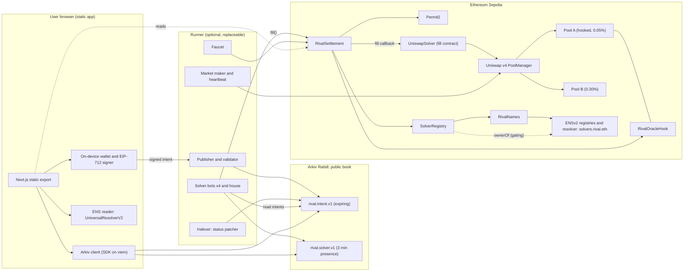
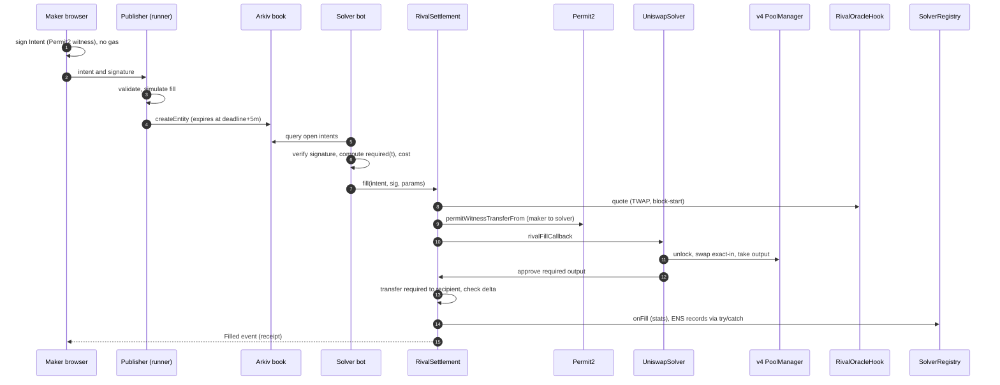
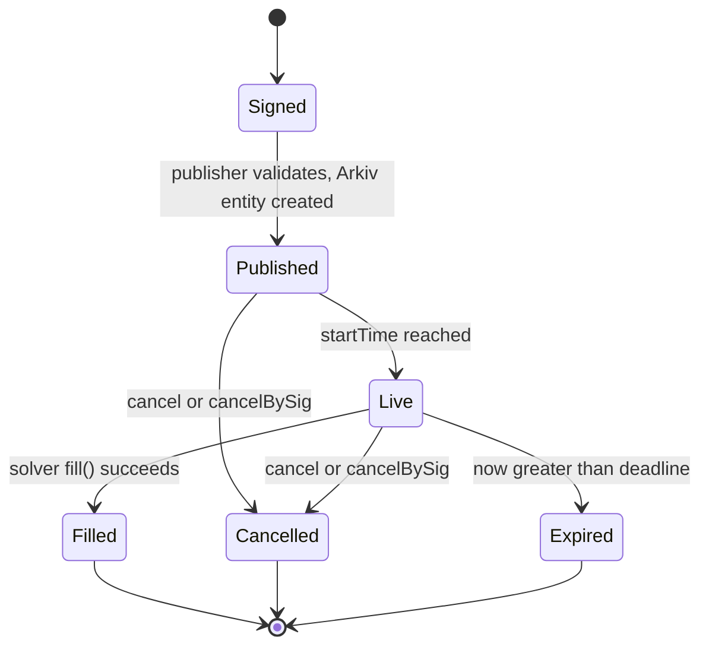
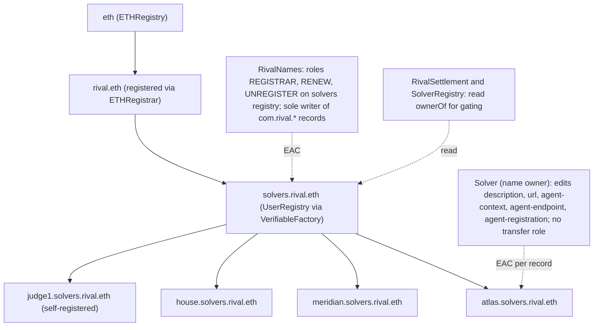
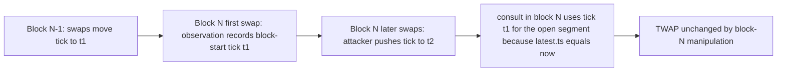

### 6.1 System architecture

### 6.2 One fill, end to end

### 6.3 Intent state machine

### 6.4 ENS name tree and permissions

### 6.5 Oracle timeline (why same-block manipulation cannot move the price)

